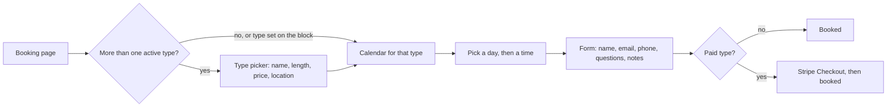

# Appointment Types and Questions

An appointment type is something visitors can book: "15-minute intro", "60-minute consult", "Paid strategy session". Each has its own length, spacing, hours, location, video setting, price and questions. Visitors pick a type first, then a time.

Manage them under **Appointments → Appointment types**. The list order is the order visitors see.

## Type settings

| Field | Values | What it does |
| --- | --- | --- |
| Name | Text | Shown to visitors and in the event title (`{type}`) |
| Description | Text | Short line under the name in the type picker |
| Length | 5–480 minutes | How long the appointment is |
| Start-time spacing | 5–480 minutes (defaults to the length) | How often start times are offered: 30 = 9:00, 9:30, 10:00… |
| Hours | Your usual hours, or own hours per day | Own hours use the same format: `09:00-12:00, 13:00-17:00`; empty = closed that day |
| Location | Text | An address or "Phone call"; falls back to the default location in Settings |
| Video call | Default / Add a video link / No video link | Google Meet for Google, Teams for Outlook work and school accounts; CalDAV has none |
| Notes field | On / off | Shows a free-text notes box on the form |
| Price | Amount in your currency (0 = free) | Paid types go through Stripe Checkout; see [Payments with Stripe](Payments-with-Stripe) |
| Active | On / off | Hidden types can't be booked; existing bookings keep working |
| Questions | Up to 20 | See below |

Shared across all types (in **Settings**): buffers, minimum notice, booking window, days off, daily cap, per-person cap and the work schedule. See [Availability Rules](Availability-Rules).

## How visitors choose

To show only one type on a page, set **Type** in the block's sidebar or use `[jat_booking type="the-type-id"]`. The ID is shown on the types list.

## Booking questions

| Kind | Shown as | Stored as |
| --- | --- | --- |
| Short answer | One-line text field | Text |
| Long answer | Multi-line text area | Text |
| Dropdown | Select with your options (one per line) | The chosen option |
| Checkbox | A single tick box | Yes / No |

Each question can be **required**. Answers go to:

| Where | Included |
| --- | --- |
| The calendar event's description | Yes |
| Owner and visitor emails | Yes |
| The booking record (Appointments → Bookings) | Yes |
| CSV export | Yes |
| WordPress personal-data export | Yes |

Answers are validated on the server: required questions must be filled, and dropdown answers must be one of your options.

## Built-in fields

| Field | Setting |
| --- | --- |
| Name | Always required |
| Email | Always required |
| Phone | Don't ask / Ask (optional) / Ask (required) |
| Consent checkbox | Shown when **Consent checkbox** text is filled in |

## Examples

| Type | Length | Spacing | Price | Video | Questions |
| --- | --- | --- | --- | --- | --- |
| Free intro call | 15 | 15 | 0 | Add a video link | "What do you need help with?" (long, required) |
| Consult | 60 | 30 | 150.00 | Default | "Website address" (short), "Budget" (dropdown) |
| On-site visit | 90 | 60 | 0 | No video link | Location "12 Main St"; "Gate code" (short) |

Related: [Availability Rules](Availability-Rules) · [Block and Shortcode](Block-and-Shortcode) · [Emails and Reminders](Emails-and-Reminders)
