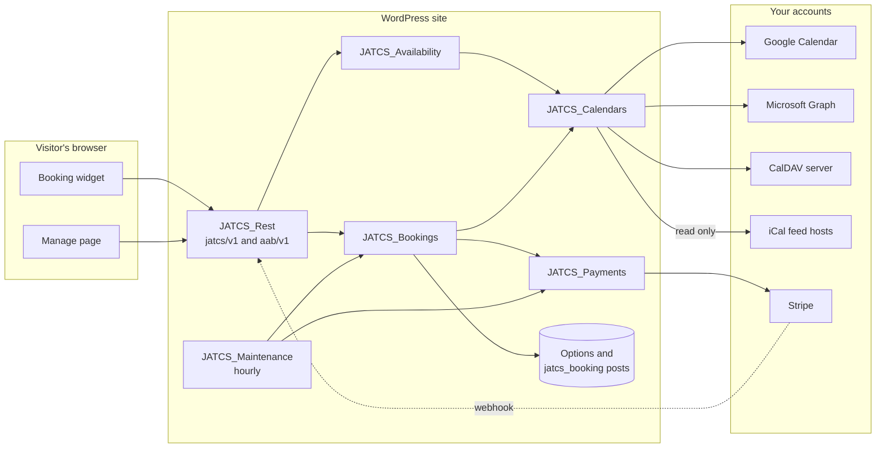
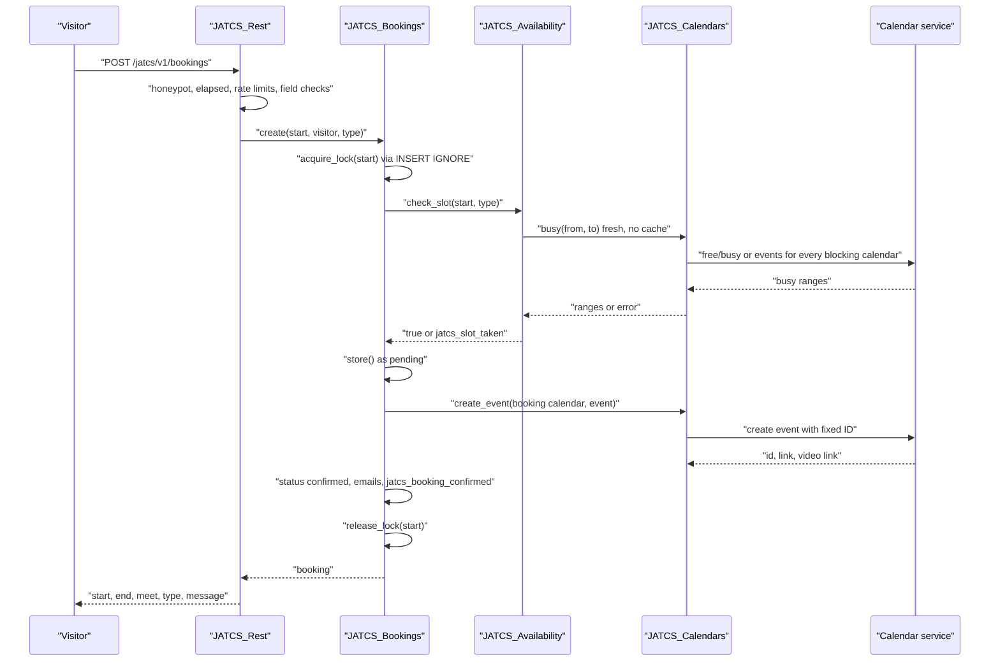

# Architecture

JAT Calendar Sync is a single WordPress plugin with no build step and no Composer dependencies. Everything runs inside WordPress: the booking widget talks to the plugin's own REST API, and the plugin talks to your calendar services and Stripe with the WordPress HTTP API.

## Components

| Component | Where | Role |
| --- | --- | --- |
| Booking widget | `assets/js/booking.js`, `assets/css/booking.css`, `blocks/booking/` | Type picker, month calendar, open times, form. Loaded only where the block or shortcode appears. |
| Manage page | `JATCS_Frontend::manage_page()` | Linked from every email: shows the appointment, reschedule, cancel, finish or release a payment. |
| REST API | `JATCS_Rest` | `jatcs/v1/availability`, `bookings`, `bookings/{id}/reschedule`, `stripe` (also under `aab/v1`). |
| Availability | `JATCS_Availability` | Candidate start times from hours and types, booking window, schedule horizon, busy-time cache, slot check. |
| Bookings | `JATCS_Bookings` | Slot lock, live re-check, booking records, calendar events, emails, privacy export and erase. |
| Calendar layer | `JATCS_Calendars` | One interface over Google, Outlook, CalDAV and iCal feeds. |
| Payments | `JATCS_Payments`, `JATCS_Stripe` | Hold the slot, Stripe Checkout, confirmation, refunds. |
| Hourly tasks | `JATCS_Maintenance` | Calendar sync, reminders, payment sweep, retention, Site Health. |
| Admin | `JATCS_Admin`, `JATCS_Admin_Types`, `includes/views/` | Settings screen, connections, appointment types, bookings list, CSV export. |
| Migration | `JATCS_Legacy` | One-time move from Anderson Appointment Booking and compatibility with its links. |

## Classes

| File | Class | Responsibility |
| --- | --- | --- |
| `jat-calendar-sync.php` | (bootstrap) | Header, constants (`JATCS_VERSION`, `JATCS_FILE`, `JATCS_DIR`, `JATCS_URL`), maps `AAB_*` wp-config constants, loads classes, hooks `plugins_loaded`, activation and deactivation. Stays idle if another copy is already loaded. |
| `class-jatcs-plugin.php` | `JATCS_Plugin` | `init()` wires every class; `activate()` runs the migration, seeds defaults, registers the post type, schedules the hourly task. |
| `class-jatcs-settings.php` | `JATCS_Settings` | `jatcs_settings` option: defaults, request cache, hours and days-off parsing. |
| `class-jatcs-types.php` | `JATCS_Types` | Appointment types (`jatcs_types` option): schema, cleaning, questions, answer validation. |
| `class-jatcs-crypto.php` | `JATCS_Crypto` | AES-256-GCM encryption of secrets; reads values written under the old name. |
| `class-jatcs-calendars.php` | `JATCS_Calendars` | Calendar references, choices for settings, blocking calendars, busy times, create/move/delete events, event state, last posted event. |
| `class-jatcs-google.php` | `JATCS_Google` | Google OAuth and Calendar v3: free/busy, calendar list, events, retries, problem log, owner alert. |
| `class-jatcs-microsoft.php` | `JATCS_Microsoft` | Microsoft Graph: OAuth with granted-scope tracking, calendar list, calendarView busy times, event create/move/cancel/state. |
| `class-jatcs-caldav.php` | `JATCS_CalDAV` | CalDAV client: discovery, calendar list, `calendar-query` REPORT, GET/PUT/DELETE, XML parsing. Moves raw iCalendar text only. |
| `class-jatcs-caldav-store.php` | `JATCS_CalDAV_Store` | The connected CalDAV account: sign-in storage, calendars, busy times, booking events. |
| `class-jatcs-feeds.php` | `JATCS_Feeds` | Subscribed iCal feeds: encrypted links, conditional download, cache, backoff, busy times. |
| `class-jatcs-ical.php` | `JATCS_ICal` | RFC 5545 parser, recurrence expansion, busy ranges, last event end, event writer. |
| `class-jatcs-availability.php` | `JATCS_Availability` | Window, schedule horizon and padding, candidates, busy cache, `slots()`, `check_slot()`. |
| `class-jatcs-bookings.php` | `JATCS_Bookings` | Post type, `create()`, `finalize()`, `reschedule()`, `cancel()`, locks, tokens, emails, `.ics` file, privacy. |
| `class-jatcs-payments.php` | `JATCS_Payments` | Checkout start, confirmation from a session, release of holds, refunds, hourly sweep. |
| `class-jatcs-stripe.php` | `JATCS_Stripe` | Stripe API calls with idempotency keys, webhook signature check, money formatting. |
| `class-jatcs-rest.php` | `JATCS_Rest` | REST routes, validation, spam checks, per-IP rate limits. |
| `class-jatcs-frontend.php` | `JATCS_Frontend` | Shortcode, block, assets, manage page, appearance preview page. |
| `class-jatcs-style.php` | `JATCS_Style` | Theme token detection and CSS variables. |
| `class-jatcs-maintenance.php` | `JATCS_Maintenance` | Hourly task and Site Health tests. |
| `class-jatcs-admin.php` | `JATCS_Admin` | Settings screen, connect/disconnect actions, bookings list columns, CSV export, privacy text. |
| `class-jatcs-admin-types.php` | `JATCS_Admin_Types` | Appointment types screen. |
| `class-jatcs-legacy.php` | `JATCS_Legacy` | Migration from Anderson Appointment Booking; old query arguments, OAuth callbacks and shortcode. |

## Component diagram

## A free booking, end to end

If the calendar can't be read, or creating the event fails, the booking is not stored: the pending record is deleted and the visitor sees an error.

## Request lifecycle

1. `plugins_loaded`: `JATCS_Plugin::init()` registers hooks. `JATCS_Legacy::init()` adds its `init` hook at priority 0, before `JATCS_Types::maybe_migrate` at priority 1.
2. `init`: the post type, block, assets and hourly schedule are registered; a pending migration runs.
3. `rest_api_init`: routes are registered under `jatcs/v1` and `aab/v1`.
4. `template_redirect`: the manage page (`?jatcs_manage=` or `?aab_manage=`) and the admin appearance preview are served here and exit.
5. The block and shortcode render a container with a JSON config. Times are fetched by the browser, so cached pages still show current availability.

## Caching

| What | Key | Lifetime | Cleared by |
| --- | --- | --- | --- |
| Busy times for a date range | transient `jatcs_busy_<md5>` | 120 seconds (`JATCS_Availability::CACHE_TTL`) | `jatcs_busy_generation` bump after any booking change, setting change or feed change. Booking and rescheduling always re-check live. |
| Schedule horizon (last posted shift) | transient `jatcs_horizon_<md5>` | 15 minutes; 2 minutes after an error | Generation bump |
| iCal feed body | option `jatcs_feed_cache_<id>` | Fresh for 10 minutes; used for up to 6 hours if the feed can't be reached; retried at most every 5 minutes after a failure | Removing the feed |
| Google calendar list | transient `jatcs_calendars` | 10 minutes | "Refresh list", connect, disconnect |
| Outlook calendar list | transient `jatcs_ms_calendars` | 10 minutes | Connect, disconnect |
| CalDAV calendar list | transient `jatcs_caldav_calendars` | 10 minutes | Connect, disconnect |
| Google calendar time zone | transient `jatcs_caltz_<md5>` | 1 day; 1 hour when unknown | Expiry |
| Google access token | transient `jatcs_access_token` (encrypted) | Token lifetime minus 120 seconds (at least 60) | 401 response, disconnect |
| Outlook access token | transient `jatcs_ms_access` (encrypted) | Token lifetime minus 120 seconds (at least 60) | 401 response, disconnect |
| Settings | static request cache in `JATCS_Settings` | One request | `JATCS_Settings::flush()` |

Related: [Home](Home) · [REST-API](REST-API) · [Data-and-Storage](Data-and-Storage) · [Reliability-and-Site-Health](Reliability-and-Site-Health) · [Calendar-Services](Calendar-Services) · [Availability-Rules](Availability-Rules)
