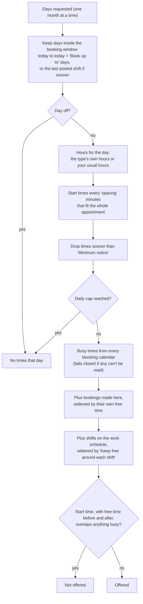
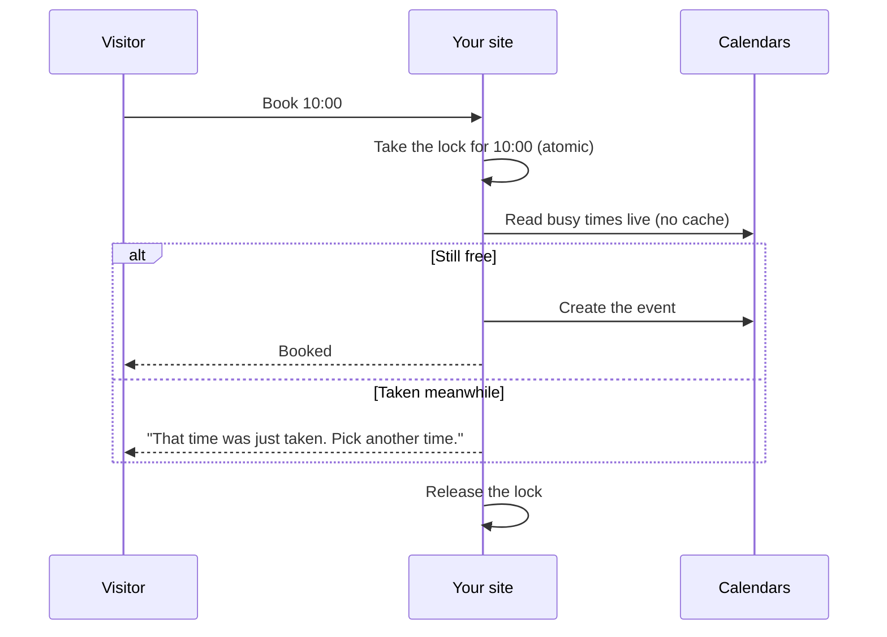

# Availability Rules

How the plugin decides which times to offer. If a time you expected is missing, walk down this page in order.

## The calculation



## Each rule

| Rule | Setting | Effect |
| --- | --- | --- |
| Hours | When people can book → each day, or the type's own hours | Only start times where the whole appointment fits inside a range |
| Start-time spacing | Type → spacing | 30 = :00 and :30; 15 = every quarter hour |
| Minimum notice | When people can book → Minimum notice (hours) | No times sooner than this from now |
| Booking window | Book up to (days ahead) | Last bookable day |
| Work schedule | Where bookings go → Open booking only as far as | Window ends at the last posted shift (optionally that Sunday); see [Shift-Work Mode](Shift-Work-Mode) |
| Days off | When people can book → Days off | Whole days closed; one date or range per line |
| Free time before / after | When people can book | Clear time around each new appointment, also kept around appointments booked here |
| Free time around shifts | Where bookings go → Keep free before and after each shift | Clear time around work-schedule events; counts toward the above, doesn't stack |
| Daily cap | Most bookings per day (0 = no limit) | Counts payment holds too |
| Per-person cap | Upcoming bookings per person (0 = no limit) | Checked at booking time, by email address |
| Busy calendars | Each service's section | Events marked busy, tentative or out of office block; free/transparent and cancelled events don't |

## Days off format

```
2026-12-24
2026-12-31 to 2027-01-02
2027-07-04  # a comment after # is ignored
```

Invalid lines are reported when you save.

## Buffers in practice

With **Free time after = 15** and a 30-minute type:

| Existing event | Last start before it | First start after it |
| --- | --- | --- |
| 10:00–11:00 in your calendar | 9:15 (ends 9:45 + 15 = 10:00) | 11:00 |
| 10:00–10:30 booked here (also keeps its 15) | 9:15 | 10:45 |
| Shift 12:00–16:00, 60 min kept free around shifts | 10:30 (ends 11:00, an hour before) | 17:00 |

## At the moment of booking

Open times are cached for 2 minutes, so a visitor's page can be slightly out of date. Booking never relies on that cache:



## Times and time zones

| Thing | Time zone |
| --- | --- |
| Your hours, days off, notice | Your site's timezone (Settings → General) |
| What visitors see | Their own browser's timezone, labelled on the widget |
| Events in your calendar | Exact instants, so they land correctly in any calendar timezone |
| Daylight saving changes | Handled when the site timezone is a city |

Related: [Calendar Services](Calendar-Services) · [Shift-Work Mode](Shift-Work-Mode) · [Settings Reference](Settings-Reference) · [Troubleshooting](Troubleshooting)
