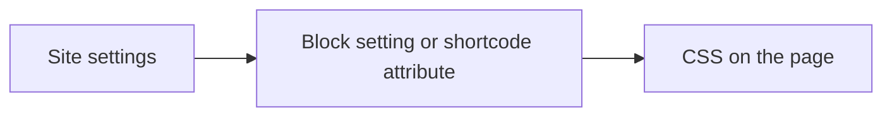

# Block and Shortcode

Put the booking calendar on any page, post or template.

## Block

Add the **Appointment Booking** block (category Widgets; search "booking", "appointment" or "calendar"). The editor shows a live, styled preview with sample times.

| Sidebar setting | Values | Default |
| --- | --- | --- |
| Heading | Text above the calendar | None |
| Appointment type | All types, or one type | All |
| Accent | Theme / a color | Site setting |
| Background | None / theme / a color | Site setting |
| Buttons | Theme / plugin | Site setting |
| Corners | auto / square / soft / rounded / round | Site setting |
| Spacing | compact / comfortable / roomy | Site setting |
| Headings | theme / inherit | Site setting |

The block also supports the editor's text and background color, font size, line height, font family, margin, padding, and wide/full alignment. You can use several blocks on one page.

## Shortcode

```
[jat_booking]
[jat_booking heading="Book a call" type="consult"]
[jat_booking accent="#1f6a2b" radius="square" density="compact"]
```

| Attribute | Accepts | Effect |
| --- | --- | --- |
| `heading` | Text | Heading above the calendar |
| `type` | A type ID | Show only that type (unknown or hidden IDs fall back to all types) |
| `accent` | A hex color | Accent color |
| `background` | `none`, `theme`, or a hex color | Calendar background |
| `buttons` | `theme`, `plugin` | Use theme buttons and fields, or the calendar's own |
| `radius` | `auto`, `square`, `soft`, `rounded`, `round` | Corners |
| `density` | `compact`, `comfortable`, `roomy` | Spacing |
| `headings` | `theme`, `inherit` | Heading font |

`[anderson_booking]`, the shortcode from before the rename, still works.

## Which wins



An empty block setting or attribute means "use the site setting".

## Caching

The page itself can be cached by any page cache or CDN. Open times are loaded from the [REST API](REST-API) when the page opens, so they're always current.

Related: [Styling and Theming](Styling-and-Theming) · [Appointment Types and Questions](Appointment-Types-and-Questions)
