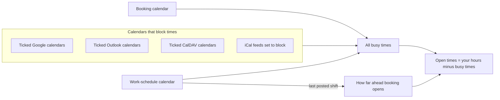

# Calendar Services

JAT Calendar Sync talks to four kinds of calendar. You can connect any mix of them. One calendar receives bookings; any number can block times.

## What each service can do

| | Google Calendar | Outlook / Microsoft 365 | CalDAV (iCloud, Fastmail, Nextcloud…) | iCal feeds |
| --- | --- | --- | --- | --- |
| Blocks times | Yes, several calendars | Yes, several calendars | Yes, several calendars | Yes, up to 20 feeds |
| Receives bookings | Yes | Yes (needs booking access) | Yes (writable calendars) | No |
| Work schedule for [Shift-Work Mode](Shift-Work-Mode) | Yes | Yes | Yes | Yes |
| Video link | Google Meet | Microsoft Teams (work and school accounts) | — | — |
| Guest invitation | Sent by Google | Sent by Outlook | Calendar file in the confirmation email | — |
| Follows moves and deletions in the calendar | Hourly | Hourly | Hourly | — |
| How it signs in | Your Google OAuth client | Your Microsoft Entra app | User name + app-specific password | A subscription link |
| How fresh busy times are | Live (cached 2 min) | Live (cached 2 min) | Live (cached 2 min) | Fetched every 10 min |
| Recurring events | Expanded by Google | Expanded by Microsoft | Expanded by the plugin | Expanded by the plugin |
| Guide | [Google Calendar](Google-Calendar) | [Outlook and Microsoft 365](Outlook-and-Microsoft-365) | [iCloud and CalDAV](iCloud-and-CalDAV) | [iCal Feeds](iCal-Feeds) |

## How calendars combine

| Calendar | Always blocks its own times? |
| --- | --- |
| The booking calendar | Yes |
| The work-schedule calendar | Yes, plus the free time you set around each shift |
| Calendars you tick | Yes, while their service is connected |
| Calendars of a disconnected service | No (unless they're the booking or work-schedule calendar) |

## When a calendar can't be read

The plugin **fails closed**: if any calendar that blocks times can't be read, it offers no times rather than risk booking over an event it couldn't see. Visitors see "Online booking is unavailable right now", and Site Health explains which calendar failed.

| Situation | What happens |
| --- | --- |
| Google or Outlook access expired | No times; owner emailed; Site Health critical |
| CalDAV password changed | No times until you reconnect |
| iCal feed briefly unreachable | Last good copy used for up to 6 hours; retried every 5 minutes |
| iCal feed down for more than 6 hours | No times until it can be read |
| A ticked calendar's service was disconnected | That calendar is ignored; booking keeps working |

## Choosing a setup

| You are… | Suggested setup |
| --- | --- |
| A consultant on Google Workspace | Bookings to Google; tick any other Google calendars |
| On Microsoft 365 at work | Bookings to Outlook with booking access (Teams links) |
| An Apple user | Bookings to iCloud via CalDAV; add work calendars as feeds or via their service |
| Working shifts plus freelancing | Bookings to your main calendar; Sling (or similar) as an iCal feed set as the work schedule |
| Split between Google and Outlook | Bookings to one; tick calendars in the other so they block times |

Related: [Getting Started](Getting-Started) · [Availability Rules](Availability-Rules) · [Reliability and Site Health](Reliability-and-Site-Health)
