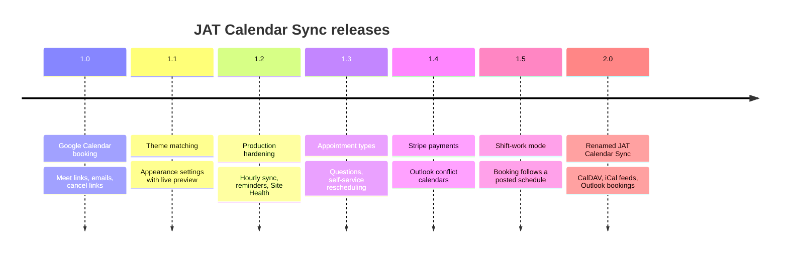

# Changelog

The full changelog is in [readme.txt](https://github.com/CptNope/JAT-Calendar-Sync/blob/main/readme.txt). Highlights:

| Version | Highlights |
| --- | --- |
| **2.0.0** | Renamed **JAT Calendar Sync** (GPLv2 or later) with automatic migration. iCloud, Fastmail, Nextcloud and any CalDAV calendar (read and write). iCal feeds with full recurring-event support. Outlook as the booking calendar with Teams links (write access opt-in). One "Where bookings go" setting across services. Site Health checks every blocking calendar can be read. Feeds over 5 MB or cut off are refused; failed feeds back off for 5 minutes. |
| 1.5.0 | Shift-work mode: booking opens only as far as a posted work schedule, with free time kept around each shift. |
| 1.4.2 | A second copy in another folder no longer causes a fatal error; deleting an extra copy no longer disconnects Google. |
| 1.4.1 | Fixed "insufficient authentication scopes" when reading the connected account and calendar timezone. |
| 1.4.0 | Stripe payments with holds and automatic refunds; Outlook / Microsoft 365 conflict calendars. |
| 1.3.0 | Appointment types, booking questions, visitor rescheduling. |
| 1.2.0 | Mirroring moves and deletions from Google, reminders, days off, Site Health, CSV export, atomic slot lock. |
| 1.1.0 | Theme matching and appearance settings. |
| 1.0.0 | First release. |

What's next is on the [roadmap](https://github.com/CptNope/JAT-Calendar-Sync/blob/main/docs/ROADMAP.md).

Related: [Migrating from Anderson Appointment Booking](Migrating-from-Anderson-Appointment-Booking) · [Home](Home)
