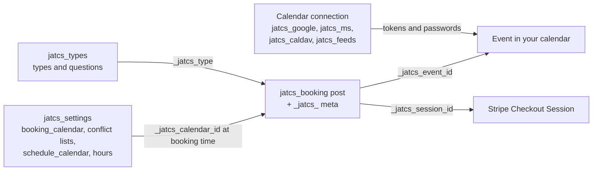
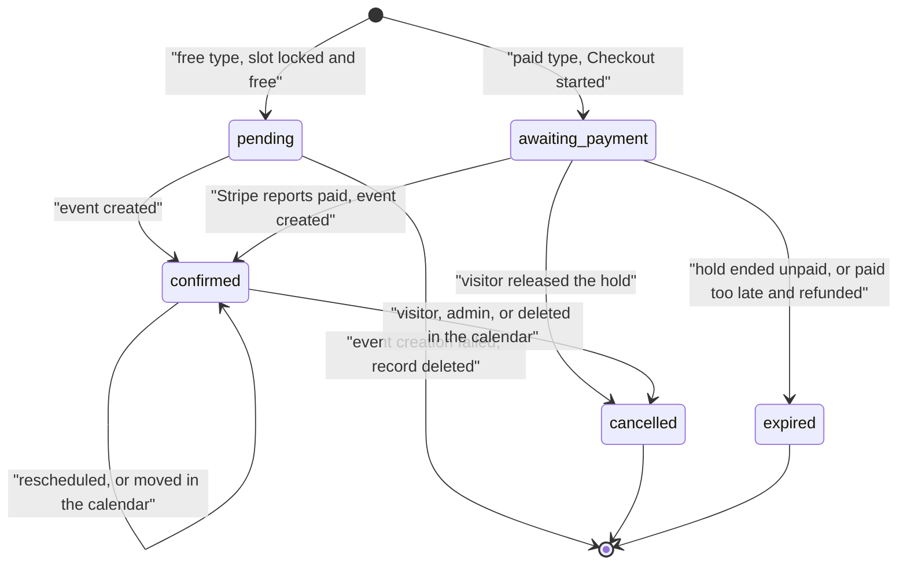

# Data and storage

Everything lives in your WordPress database: bookings as posts of a private post type, configuration in options, short-lived data in transients. Nothing is stored on a third-party booking service. Booking data also goes into the event created in your own calendar.

## Post type `jatcs_booking`

| Property | Value |
| --- | --- |
| Public | No (no front-end URLs, not in REST) |
| Admin | Appointments → Bookings, for users with `manage_options` |
| Created | Only by the plugin (`create_posts` is `do_not_allow`) |
| Title | `Name, date and time` |
| Post status | `publish`; the booking's own status is in `_jatcs_status` |
| Trash | Trashing an upcoming confirmed booking cancels it (calendar event removed, visitor emailed) |

### Meta keys

| Key | Meaning |
| --- | --- |
| `_jatcs_start`, `_jatcs_end` | Unix start and end |
| `_jatcs_date` | Start date `Y-m-d` in the site time zone (used for daily caps) |
| `_jatcs_name`, `_jatcs_email`, `_jatcs_phone`, `_jatcs_notes` | Visitor details |
| `_jatcs_answers` | Answers to booking questions: list of `{label, value}` |
| `_jatcs_type`, `_jatcs_type_name` | Appointment type ID and its name at booking time |
| `_jatcs_location` | Location at booking time |
| `_jatcs_meet` | 1 when a video link was requested |
| `_jatcs_status` | `pending`, `awaiting_payment`, `confirmed`, `cancelled`, `expired` |
| `_jatcs_calendar_id` | Booking calendar reference when booked (`primary`, `ms:…`, `caldav:…`) |
| `_jatcs_event_gid` | Event ID chosen before creating the event (makes Google creates repeatable) and UID for CalDAV and Outlook |
| `_jatcs_event_id` | Event ID returned by the calendar service (a CalDAV event URL for CalDAV) |
| `_jatcs_event_link` | Link to the event (Google, Outlook) |
| `_jatcs_meet_link` | Google Meet or Teams join link |
| `_jatcs_cancel_hash` | HMAC-SHA256 of the visitor's manage token (keyed with the `nonce` salt) |
| `_jatcs_cancel_enc` | The manage token, encrypted, so later emails can include the link |
| `_jatcs_reschedules` | Times the visitor moved it |
| `_jatcs_reminded` | Unix time the reminder was handled (set even when no reminder was due) |
| `_jatcs_cancelled_by` | `visitor`, `admin` or `calendar` |
| `_jatcs_amount`, `_jatcs_currency` | Price in minor units and currency (paid types) |
| `_jatcs_hold_until` | End of the unpaid hold |
| `_jatcs_session_id`, `_jatcs_checkout_url` | Stripe Checkout Session |
| `_jatcs_page` | Page the visitor booked from (return address after Stripe) |
| `_jatcs_paid_at`, `_jatcs_payment_intent` | Payment confirmation |
| `_jatcs_refunded_at`, `_jatcs_refund_id`, `_jatcs_refund_error` | Refund result |
| `_jatcs_owner_alerted` | Owner already told a paid booking is waiting for the calendar |

## Options

| Option | Autoload | Contents |
| --- | --- | --- |
| `jatcs_settings` | yes | All settings (see [Settings-Reference](Settings-Reference)); secrets inside are encrypted |
| `jatcs_types` | yes | Appointment types: `id, name, description, duration, interval, custom_hours, hours, location, meet (default/on/off), notes, questions, active, price` |
| `jatcs_google` | no | `refresh_token` (encrypted), `email`, `connected_at` |
| `jatcs_google_error` | no | `{message, time}` when Google refused the token; cleared on success |
| `jatcs_ms` | no | `refresh_token` (encrypted), `email`, `connected_at`, `scopes` granted |
| `jatcs_ms_error` | no | Same shape, for Outlook |
| `jatcs_caldav` | no | `preset, url, username, password` (encrypted)`, home, connected_at` |
| `jatcs_feeds` | no | Feeds: `id => {name, url (encrypted), block, added}` |
| `jatcs_feeds_version` | no | Counter bumped when feeds change |
| `jatcs_feed_cache_<id>` | no | `{body, etag, modified, fetched}`, plus `failed_at, error` after a failed fetch |
| `jatcs_log` | no | Last 20 problems talking to calendars and Stripe: `{time, context, message}` |
| `jatcs_busy_generation` | no | Counter that invalidates busy-time caches |
| `jatcs_last_run` | no | Unix time of the last hourly run |
| `jatcs_installed` | no | Unix time of first activation |
| `jatcs_migrated` | no | Migration report (see [`jatcs_migrated`](Hooks-and-Filters#jatcs_migrated)) |
| `jatcs_migrated_notice` | no | Show the one-time "took over" notice |
| `jatcs_legacy_backup` | no | Old settings and types, without secrets |
| `jatcs_legacy_google_redirect`, `jatcs_legacy_ms_redirect` | no | Keep using the redirect address registered before the rename |
| `_jatcs_lock_<start>` | no | Slot lock row (deleted when the request finishes) |
| `_jatcs_lock_fin_<id>`, `_jatcs_lock_migrate` | no | Named locks for confirming a booking and for the migration |

## Transients

| Transient | Lifetime | Contents |
| --- | --- | --- |
| `jatcs_busy_<md5>` | 120 s | Busy ranges for a date range and calendar set |
| `jatcs_horizon_<md5>` | 15 min (2 min after an error) | Last bookable date for shift-work mode |
| `jatcs_access_token`, `jatcs_ms_access` | Token lifetime | Encrypted OAuth access tokens |
| `jatcs_calendars`, `jatcs_ms_calendars`, `jatcs_caldav_calendars` | 10 min | Calendar lists |
| `jatcs_caltz_<md5>` | 1 day | Google calendar time zone |
| `jatcs_rl_<bucket>_<hmac>` | 1 hour | Rate-limit counters |
| `jatcs_oauth_state_<user>`, `jatcs_ms_state_<user>`, `jatcs_ms_write_<user>` | 15 min | OAuth sign-in state |
| `jatcs_notice_<user>`, `jatcs_types_notice_<user>`, `jatcs_type_draft_<user>` | 1–5 min | Admin notices and unsaved type edits |

## Scheduled task

| Hook | Recurrence | Runs |
| --- | --- | --- |
| `jatcs_hourly` | `hourly` (first run 5 minutes after scheduling) | Calendar sync, reminders, payment sweep, retention. See [Reliability-and-Site-Health](Reliability-and-Site-Health). |

## How records relate

## Booking status

A paid booking whose event can't be created yet stays `awaiting_payment` with `paid_at` set; it keeps its slot and the hourly sweep retries.

## Uninstall

| Always removed | Removed only with "Delete all settings and booking records" |
| --- | --- |
| Google grant revoked at Google, then `jatcs_google`, `jatcs_google_error` | `jatcs_settings`, `jatcs_types` |
| `jatcs_ms`, `jatcs_ms_error` and the Outlook token and calendar transients | `jatcs_migrated`, `jatcs_legacy_backup` |
| `jatcs_caldav` and its calendar list | Every `jatcs_booking` post and its meta |
| `jatcs_feeds`, `jatcs_feeds_version`, every `jatcs_feed_cache_<id>` | |
| `jatcs_log`, `jatcs_busy_generation`, `jatcs_last_run`, `jatcs_installed` | |
| `jatcs_legacy_google_redirect`, `jatcs_legacy_ms_redirect`, `jatcs_migrated_notice` | |
| The `jatcs_hourly` event, `jatcs_access_token`, `jatcs_calendars` | |

Events already in your calendars are never touched. If another copy of the plugin (same `jat-calendar-sync.php` file name, different folder) is still active, uninstall does nothing.

Related: [Architecture](Architecture) · [Hooks-and-Filters](Hooks-and-Filters) · [Security-and-Privacy](Security-and-Privacy) · [Settings-Reference](Settings-Reference) · [Migrating-from-Anderson-Appointment-Booking](Migrating-from-Anderson-Appointment-Booking)
