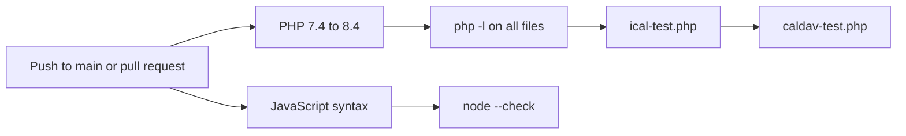

# Development and testing

The plugin has no build step and no runtime dependencies: edit a file and reload. It needs WordPress 6.2 or later and PHP 7.4 or later.

## Repository layout

| Path | Contents |
| --- | --- |
| `jat-calendar-sync.php` | Plugin header (version, requirements) and bootstrap |
| `includes/` | One class per file, `class-jatcs-*.php` (see [Architecture](Architecture)) |
| `includes/views/` | Admin screen templates |
| `assets/js/` | `booking.js` (widget and manage page), `admin.js`, `admin-types.js` |
| `assets/css/` | `booking.css`, `admin.css` |
| `blocks/booking/` | `block.json`, `index.js`, `index.asset.php` (hand-written, no bundler) |
| `languages/` | `jat-calendar-sync.pot` |
| `tests/` | `ical-test.php`, `caldav-test.php` and `fixtures/` (`icloud.ics`, `outlook.ics`, `sling.ics`) |
| `uninstall.php` | Cleanup (see [Data-and-Storage](Data-and-Storage#uninstall)) |
| `readme.txt` | WordPress.org readme |
| `.wordpress-org/` | Directory banners, icons and screenshots |
| `docs/` | Roadmap, research notes and these wiki pages |

## Running the tests

The tests are plain PHP scripts with no framework and no WordPress install. They load a single class and print pass/fail counts; the exit code is non-zero on failure.

```bash
php tests/ical-test.php     # iCalendar parser, recurrence, time zones, real-world fixtures
php tests/caldav-test.php   # CalDAV client against a scripted fake transport
```

Check syntax the same way CI does:

```bash
find . -name '*.php' -not -path './vendor/*' -print0 | xargs -0 -n1 php -l
for f in assets/js/*.js blocks/*/index.js; do node --check "$f"; done
```

## Continuous integration

`.github/workflows/ci.yml` runs on pushes to `main` and on every pull request.

| Job | Matrix | Steps |
| --- | --- | --- |
| `PHP <version>` | 7.4, 8.0, 8.1, 8.2, 8.3, 8.4 (`fail-fast: false`) | `php -l` on every PHP file, `php tests/ical-test.php`, `php tests/caldav-test.php` |
| `JavaScript syntax` | Node 20 | `node --check` on `assets/js/*.js` and `blocks/*/index.js` |



## Testing in WordPress

| What | How |
| --- | --- |
| Google | Your own OAuth client; keep the consent screen in Testing with yourself as a test user (access expires after 7 days) |
| Outlook | An app registration in Microsoft Entra; personal accounts work |
| CalDAV | iCloud with an app-specific password, or a local Radicale or Nextcloud (`http://localhost` is allowed) |
| Stripe | Test-mode keys; `stripe listen --forward-to https://your-site.example/wp-json/jatcs/v1/stripe` and use the printed signing secret |
| Hourly task | `wp cron event run jatcs_hourly` |
| Site Health | Tools → Site Health → Status |
| Translations | `wp i18n make-pot . languages/jat-calendar-sync.pot --domain=jat-calendar-sync --exclude=tests,docs,.wordpress-org` |
| WordPress.org checks | `wp plugin check jat-calendar-sync` (Plugin Check plugin) |

## Release packages

Release zips are made with `git archive`. `.gitattributes` leaves out `.github/`, `.gitattributes`, `.distignore`, `README.md` and `docs/`. `.distignore` lists the same development files (plus `tests/`, `.wordpress-org/`, `vendor/`, `node_modules/` and tooling configs) for `wp dist-archive` and the WordPress.org deploy.

## Conventions

| Topic | Rule |
| --- | --- |
| Prefix | Classes `JATCS_`, options, hooks and meta `jatcs_` / `_jatcs_`, REST namespace `jatcs/v1` |
| Text domain | `jat-calendar-sync` |
| Errors | Return `WP_Error` with a `jatcs_` code; visitor-facing messages are translated |
| Coding standard | WordPress Coding Standards; deliberate exceptions are marked inline with `phpcs:ignore` and a reason |
| Compatibility | Keep PHP 7.4 syntax; the old `aab/v1` routes, `aab_*` query arguments and shortcode must keep working |
| Changes | Through pull requests: `main` is protected |

Related: [Architecture](Architecture) · [REST-API](REST-API) · [Hooks-and-Filters](Hooks-and-Filters) · [Changelog](Changelog) · [Home](Home)
