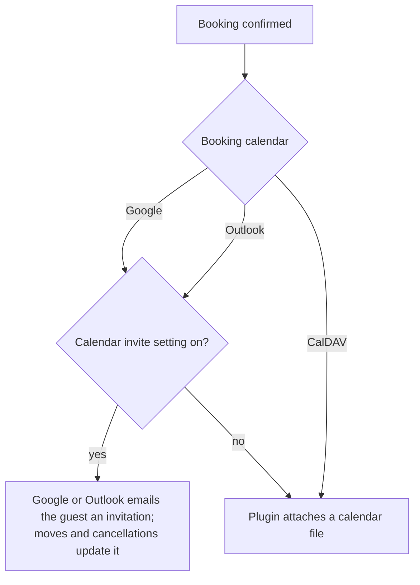

# Emails and Reminders

The plugin sends plain-text emails through WordPress (`wp_mail`), so they use whatever mail setup your site has. For reliable delivery, use an SMTP or transactional mail plugin.

## Every email

| Email | To | When | Subject |
| --- | --- | --- | --- |
| Booking confirmed | Visitor | Booking confirmed (after payment for paid types) | `[Site] Appointment booked: <time>` |
| New booking | You | Same moment | `[Site] New booking from <name>` |
| Reminder | Visitor | **Reminder email** hours before (0 = off) | `[Site] Reminder: appointment <time>` |
| Moved | Visitor | They rescheduled, or you moved the event in your calendar | `[Site] Appointment moved to <time>` |
| Rescheduled | You | A visitor rescheduled | `[Site] <name> rescheduled` |
| Cancelled | Visitor | Any cancellation (with refund details) | `[Site] Appointment cancelled: <time>` |
| Cancelled | You | A visitor cancelled | Same subject |
| Paid booking waiting | You | Paid, but the calendar couldn't be reached (retried hourly) | `[Site] Paid booking waiting for your calendar` |
| Refund failed | You | Stripe refused a refund | Refund problem notice |
| Late payment refunded | Visitor | A payment arrived after the hold expired and the time was gone | Refund notice |
| Booking offline | You | Google Calendar access expired or was revoked (once per outage) | `[Site] Online booking is offline: reconnect Google Calendar` |

"You" means the **Notify me at** address (defaults to the site admin email). Owner emails set **Reply-To** to the visitor, and visitor emails set it to you, so either side can just reply.

Outlook and CalDAV connection problems don't send an email; they show as a notice in wp-admin and as a critical item in **Tools → Site Health**.

## What a confirmation contains

| Part | Included |
| --- | --- |
| Date and time | In your site's timezone |
| Appointment type and length | Yes |
| Location | When set on the type or in Settings |
| Video link | Google Meet or Teams, when created |
| Answers and notes | Yes |
| Manage link | Reschedule or cancel |
| Calendar file (.ics) | Attached when the calendar service isn't sending its own invitation (CalDAV, or guest invites turned off) |
| Your message | **Message after booking** setting |

## Invitations vs calendar files

## Reminders

- Sent by the hourly task, so they arrive within an hour of the set time.
- A booking made inside its own reminder window (for example, booked this afternoon for this evening) gets no reminder, since the confirmation just went out.
- A moved appointment gets a fresh reminder for its new time.
- Google and Outlook also remind invited guests themselves.

If reminders don't go out, check that WP-Cron runs: see [Reliability and Site Health](Reliability-and-Site-Health).

Related: [Rescheduling and Cancelling](Rescheduling-and-Cancelling) · [Settings Reference](Settings-Reference) · [Troubleshooting](Troubleshooting)
