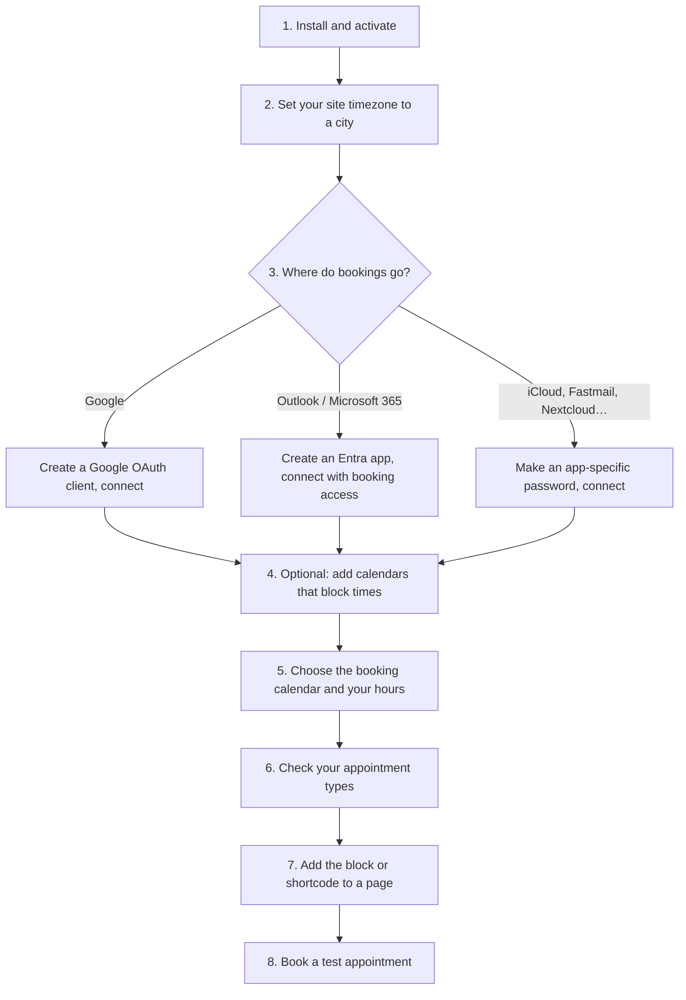

# Getting Started

From install to your first booking in about 15 minutes. Most of that is creating the sign-in app for your calendar service.

## Overview

## 1. Install

| Method | Steps |
| --- | --- |
| From WordPress.org | Plugins → Add New → search **JAT Calendar Sync** → Install → Activate |
| From a zip | Plugins → Add New → Upload Plugin → choose `jat-calendar-sync.zip` → Install → Activate |
| Moving from Anderson Appointment Booking | Install and activate as above; everything moves over by itself. See [Migrating](Migrating-from-Anderson-Appointment-Booking) |

The plugin adds an **Appointments** menu with **Settings**, **Appointment types** and **Bookings**.

## 2. Timezone

Go to **Settings → General → Timezone** and pick a city (for example *New York*), not a fixed offset like *UTC−5*. A fixed offset ignores daylight saving time, so your hours would shift by an hour twice a year. The settings screen and Site Health both warn if this isn't set.

## 3. Connect a calendar that can receive bookings

You need at least one of these. Pick the calendar you live in.

| Service | What you need | Time | Guide |
| --- | --- | --- | --- |
| Google Calendar | A Google Cloud project with your own OAuth client | ~5 min | [Google Calendar](Google-Calendar) |
| Outlook / Microsoft 365 | A Microsoft Entra app registration | ~5 min | [Outlook and Microsoft 365](Outlook-and-Microsoft-365) |
| iCloud | An app-specific password from account.apple.com | ~2 min | [iCloud and CalDAV](iCloud-and-CalDAV) |
| Fastmail, Nextcloud, Zoho, Yahoo, mailbox.org, other CalDAV | An app password | ~2 min | [iCloud and CalDAV](iCloud-and-CalDAV) |

Why your own Google or Microsoft app? So no third party (including us) ever holds access to your calendar. The plugin talks to your calendar service directly from your server.

## 4. Optional: calendars that only block times

Anything else you're busy in can block times without receiving bookings:

- other Google, Outlook or CalDAV calendars (tick them in their section)
- iCal feeds: shift schedules, shared family calendars, published calendars ([iCal Feeds](iCal-Feeds))

## 5. Where bookings go, and your hours

| Setting | Where | Typical choice |
| --- | --- | --- |
| Add bookings to | Settings → Where bookings go | Your main calendar |
| Open booking only as far as | Settings → Where bookings go | Leave off, or choose your work schedule ([Shift-Work Mode](Shift-Work-Mode)) |
| Hours for each day | Settings → When people can book | `09:00-17:00`, breaks as `09:00-12:00, 13:00-17:00` |
| Free time before / after | Settings → When people can book | 0 / 15 minutes |
| Minimum notice | Settings → When people can book | 4–24 hours |
| Book up to | Settings → When people can book | 14–30 days ahead |

Every setting is listed in the [Settings Reference](Settings-Reference).

## 6. Appointment types

One type is created for you. Under **Appointments → Appointment types** you can rename it, change its length, add a price, questions, a location or a video call, or add more types. See [Appointment Types and Questions](Appointment-Types-and-Questions).

## 7. Put the calendar on a page

| Method | How |
| --- | --- |
| Block editor | Add the **Appointment Booking** block |
| Shortcode | `[jat_booking]`, or `[jat_booking type="consult"]` for one type |

More options in [Block and Shortcode](Block-and-Shortcode).

## 8. Test it

1. Open the page in a private window and book a time with your own email address.
2. Check: the event appears in your booking calendar, you get the owner email, and the visitor email arrives with a manage link.
3. Open the manage link, move the appointment, then cancel it. The calendar event should move, then disappear.
4. Look at **Tools → Site Health**: the JAT Calendar Sync checks should be green.

## Checklist

| Check | Where to look |
| --- | --- |
| Times appear on the booking page | Your page |
| "Right now: booking is open through …" (shift-work mode only) | Settings → Where bookings go |
| No red messages | Settings, and Tools → Site Health |
| Hourly task running | Settings shows "Last checked your calendar … ago" |

Related: [Calendar Services](Calendar-Services) · [Settings Reference](Settings-Reference) · [Troubleshooting](Troubleshooting)
