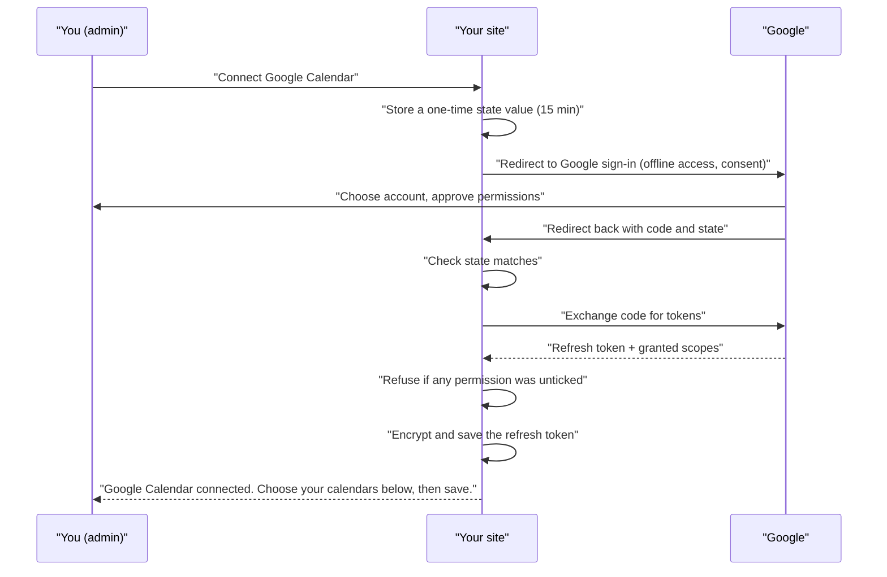
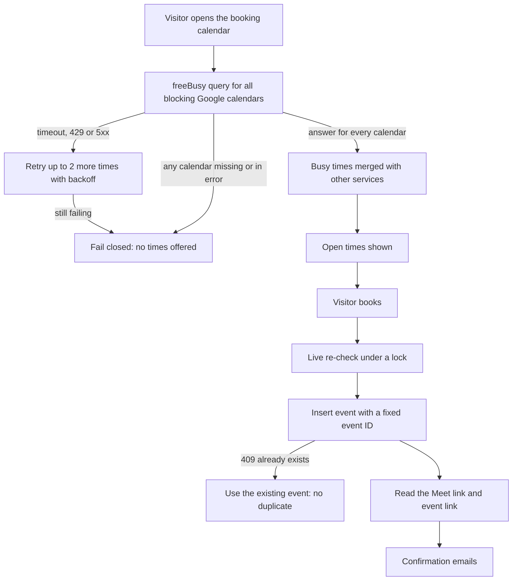

# Google Calendar

Google Calendar can do two jobs in JAT Calendar Sync: its busy times block bookings, and it can be the calendar new bookings are added to (with a Google Meet link and an invitation for the visitor). The plugin connects with **your own** Google OAuth client, so no third-party service sits between your site and your calendar.

## What it does

| Feature | Details |
| --- | --- |
| Blocks times | Busy times from the booking calendar, the work-schedule calendar and every calendar ticked under **Google calendars that block times** |
| Receives bookings | Any calendar where your account is owner or writer can be chosen under **Where bookings go → Add bookings to** |
| Video link | Google Meet, when the appointment type or the **Video call** setting asks for one |
| Guest invitation | Sent by Google when **Calendar invite** is on (the visitor is added as a guest) |
| Follows your changes | Moving or deleting the event in Google Calendar updates or cancels the booking within the hour, and the visitor is emailed |
| Permissions asked for | `calendar.events`, `calendar.freebusy`, `calendar.calendarlist.readonly`: read busy times, list calendars, manage events. Event details on other calendars are never read |
| Credentials | Client secret and refresh token are encrypted at rest; you can define `JATCS_GOOGLE_CLIENT_ID` and `JATCS_GOOGLE_CLIENT_SECRET` in `wp-config.php` instead |

## Setup

| Step | Where | What to do |
| --- | --- | --- |
| 1 | [Google Cloud Console](https://console.cloud.google.com/apis/library/calendar-json.googleapis.com) | Create a project (or pick one) and enable the **Google Calendar API** |
| 2 | Google Auth Platform (OAuth consent screen) | Choose **External**, fill in the app name and your email |
| 3 | Audience | Click **Publish app** so it is **In production**. Apps left in Testing lose access after 7 days and booking stops |
| 4 | Clients | Create an OAuth client of type **Web application**. Add the **Authorized redirect URI** shown on the settings page (normally `https://your-site/wp-admin/admin-post.php?action=jatcs_oauth`) |
| 5 | Appointments → Settings → Google credentials | Paste the **Client ID** and **Client secret**, then **Save settings** |
| 6 | Appointments → Settings → Google Calendar | Click **Connect Google Calendar**. You see Google's "unverified app" screen once; continue, and leave every permission ticked |
| 7 | Google calendars that block times | Tick other Google calendars whose busy events should hide times, then save |
| 8 | Where bookings go | Choose the Google calendar under **Add bookings to** |

You don't need Google's app verification to use your own app with your own account.

> **Sites moved from Anderson Appointment Booking** keep using the redirect address already registered in Google Cloud (`…?action=aab_oauth`). The settings page shows whichever address applies to your site.

## How connecting works

## How busy times and bookings flow

Every request is retried on timeouts, rate limits and server errors (three attempts in total). Event IDs are chosen by the plugin before the event is created, so a retried create can never make a second event.

## Troubleshooting

| Symptom | Cause | Fix |
| --- | --- | --- |
| Booking stops after about a week; owner gets "Online booking is offline: reconnect Google Calendar" | The Google app is still in **Testing**, or access was revoked or the password changed | Publish the app to **In production**, then **Connect Google Calendar** again |
| "Google did not return a refresh token…" | Google remembered an earlier grant | Remove the app at Google Account → Security → Third-party access, then connect again |
| "Some calendar permissions were not granted…" | A permission checkbox was unticked on Google's screen | Connect again and leave every permission ticked |
| "The connection request expired or did not match…" | The sign-in took longer than 15 minutes or was opened twice | Click **Connect Google Calendar** again |
| `redirect_uri_mismatch` on Google's page | The redirect URI in Google Cloud differs from the one on the settings page | Copy the exact address from the settings page into the OAuth client |
| No times offered at all | A blocking Google calendar can't be read | Check **Recent problems talking to your calendars** at the bottom of the settings page and Tools → Site Health |
| A shared calendar can't be chosen for bookings | Your account isn't owner or writer of it | Ask for "Make changes to events" access, or pick another calendar |
| Changing the client ID or secret disconnected Google | New credentials need a new connection | Click **Connect Google Calendar** again |

Related: [Calendar services](Calendar-Services) · [Shift-work mode](Shift-Work-Mode) · [Availability rules](Availability-Rules) · [Reliability and Site Health](Reliability-and-Site-Health) · [Troubleshooting](Troubleshooting)
