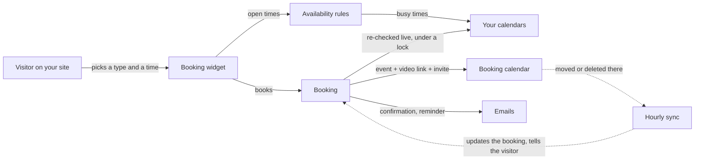

# JAT Calendar Sync

Free appointment booking for WordPress that syncs with **Google Calendar, Outlook / Microsoft 365, iCloud and any CalDAV server, and any iCal feed**, matches your theme, and never double-books. Every feature is free: no add-ons, no paid tier, no account with us.

*Formerly Anderson Appointment Booking. Existing sites move over automatically: see [Migrating from Anderson Appointment Booking](Migrating-from-Anderson-Appointment-Booking).*

## Start here

| I want to… | Read |
| --- | --- |
| Install it and take my first booking | [Getting Started](Getting-Started) |
| Choose which calendars to connect | [Calendar Services](Calendar-Services) |
| Book around a work schedule (Sling, When I Work, Deputy) | [Shift-Work Mode](Shift-Work-Mode) |
| Offer different kinds of appointments, with questions | [Appointment Types and Questions](Appointment-Types-and-Questions) |
| Understand why a time is or isn't offered | [Availability Rules](Availability-Rules) |
| Charge for appointments | [Payments with Stripe](Payments-with-Stripe) |
| Make it look like my site | [Styling and Theming](Styling-and-Theming) |
| Put it on a page | [Block and Shortcode](Block-and-Shortcode) |
| Fix something | [Troubleshooting](Troubleshooting) and [FAQ](FAQ) |
| Build on it | [Architecture](Architecture), [REST API](REST-API), [Hooks and Filters](Hooks-and-Filters) |

## How it fits together

## What it works with

| Service | Blocks times | Receives bookings | Video link |
| --- | --- | --- | --- |
| [Google Calendar](Google-Calendar) | Yes | Yes | Google Meet |
| [Outlook / Microsoft 365](Outlook-and-Microsoft-365) | Yes | Yes | Microsoft Teams (work and school) |
| [iCloud, Fastmail, Nextcloud and other CalDAV](iCloud-and-CalDAV) | Yes | Yes | — |
| [iCal feeds](iCal-Feeds) (Sling, shared and published calendars) | Yes | No (read only) | — |

## Promises the plugin keeps

| Promise | How |
| --- | --- |
| Never double-books | Every time is re-checked live at the moment of booking, under an atomic lock; if any calendar that blocks times can't be read, no times are offered |
| Your data stays yours | Bookings live in your WordPress database and your own calendar; no third-party booking service |
| Looks native | Reads your theme's colors, fonts, buttons and corners automatically |
| Changes flow both ways | Moving or deleting an appointment in your calendar updates the booking and emails the visitor |
| Secrets stay secret | Tokens, app passwords and feed links are encrypted at rest |

## Requirements

| | Minimum |
| --- | --- |
| WordPress | 6.2 |
| PHP | 7.4 (tested on 7.4 to 8.4) |
| A calendar | Google, Outlook / Microsoft 365, or a CalDAV account for bookings |
| Site timezone | A city (not a fixed UTC offset), so daylight saving time is handled |

## Links

- Source and issues: [GitHub](https://github.com/CptNope/JAT-Calendar-Sync)
- Author: [Jeremy Anderson Tech](https://jeremyanderson.tech)
- License: GPLv2 or later
