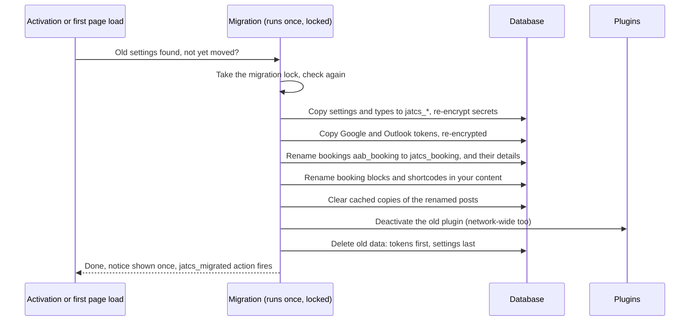

# Migrating from Anderson Appointment Booking

JAT Calendar Sync 2.0 is the same plugin under a new name. Installing it on a site that runs Anderson Appointment Booking moves everything over automatically, once, the first time it's activated (or on the next page load).

> **The move is one-way.** The old plugin's data is renamed, not copied, so you can't switch back without a backup. Back up your site first.

## Steps

| Step | What to do |
| --- | --- |
| 1 | Back up the site (files and database) |
| 2 | Install JAT Calendar Sync (Plugins → Add New → Upload Plugin, or from WordPress.org) |
| 3 | Activate it. The old plugin is deactivated for you, and a notice lists what moved |
| 4 | Open Appointments → Settings and check your calendars, hours and booking page |
| 5 | Delete the old plugin from the Plugins page (safe now; see below) |

## What happens

## What carries over, and what keeps working

| Item | After the move |
| --- | --- |
| Settings and appointment types | Moved to `jatcs_settings` / `jatcs_types` |
| Bookings and their details | Moved (only booking records are touched) |
| Google Calendar connection | Kept; no reconnecting |
| Outlook connection | Kept (read-only as before; click **Allow adding bookings to Outlook** to let it receive bookings) |
| Encrypted secrets | Re-encrypted with the new key |
| Google and Microsoft redirect addresses | The old `action=aab_oauth` / `aab_ms_oauth` addresses keep working, so you don't change them in Google Cloud or Entra |
| Booking pages | Blocks and shortcodes renamed; `[anderson_booking]` and the old block name also still render |
| Pages cached before the switch | The old `/wp-json/aab/v1/...` addresses still answer |
| Stripe webhook | `/wp-json/aab/v1/stripe` still works; checkouts started before the switch still confirm |
| Links in emails already sent | `?aab_manage=…` links still open the manage page |
| wp-config.php constants | `AAB_*` constants are read as `JATCS_*` |
| Custom CSS | `.aab…` classes and `--aab-…` variables in your custom CSS setting are renamed |
| A backup | Old settings and types (without secrets) are kept in the `jatcs_legacy_backup` option |

## Deleting the old plugin

After the move, the old plugin's data is gone, so its uninstall step has nothing to disconnect. Delete it normally from the Plugins page. If you had installed it twice (for example a GitHub download in `WordPress-Calendar-Sync-Plugin-main` and an upload in `anderson-appointment-booking`), delete both.

| Old version | Delete from the Plugins page? |
| --- | --- |
| Before the move | Don't: it would revoke the Google connection |
| After the move | Yes, safely |

## If something looks wrong

| Symptom | Check |
| --- | --- |
| No notice after activating | It shows once, on the Plugins page or Dashboard. Settings carrying over is the real test |
| Booking page shows nothing | The page may be cached: purge your page cache or CDN (the `jatcs_migrated` action is there for cache plugins) |
| Google shows "not connected" | Your site's salts or `AAB_ENCRYPTION_KEY` changed between versions; reconnect |
| Old plugin still active on a multisite network | Network-deactivate it under Network Admin → Plugins |

Related: [Getting Started](Getting-Started) · [Data and Storage](Data-and-Storage) · [Changelog](Changelog)
