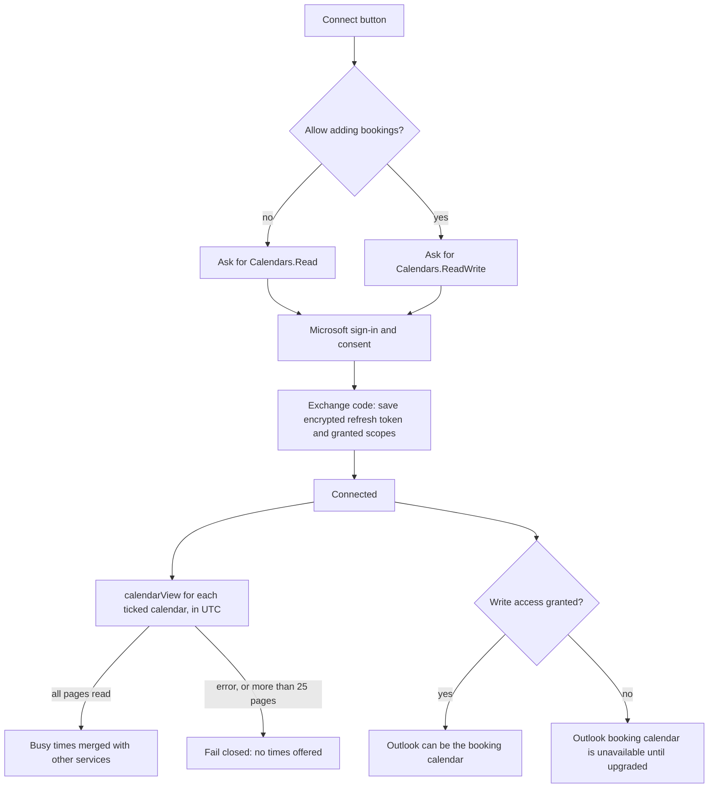
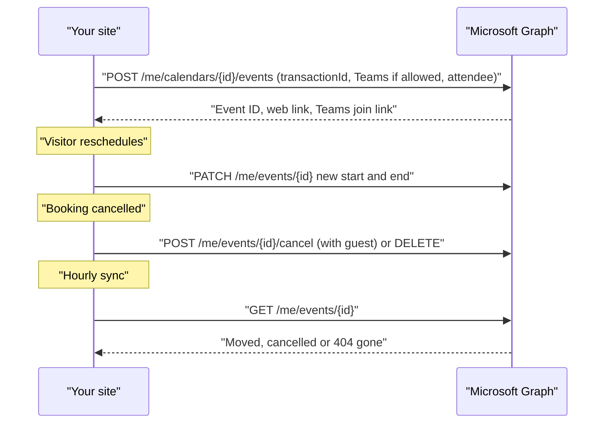

# Outlook and Microsoft 365

Outlook calendars (Microsoft 365 work or school accounts, and personal Outlook.com accounts) can block times, and an Outlook calendar can also be where new bookings go, with a Microsoft Teams link on work and school accounts. The plugin talks to Microsoft Graph using **your own** app registration in Microsoft Entra.

## What it does

| Feature | Details |
| --- | --- |
| Blocks times | Events shown as **Busy**, **Tentative**, **Out of office** (or unknown) block times; **Free** and **Working elsewhere** don't. Cancelled meetings are ignored. Recurring meetings are included |
| Receives bookings | Only with write access (see below), on calendars your account can edit |
| Video link | Microsoft Teams, when the calendar allows Teams meetings (work and school accounts). On personal accounts the plugin uses the consumer online-meeting type only if Outlook reports one for that calendar; otherwise no link |
| Guest invitation | Sent by Outlook when **Calendar invite** is on |
| Cancelling | With guests, Outlook's own cancellation is sent; otherwise the event is deleted |
| Follows your changes | Moving or deleting the event in Outlook updates or cancels the booking within the hour |
| Duplicates | Each create carries a `transactionId`, so a retry never makes a second event |
| Permissions | `Calendars.Read` to block times, or `Calendars.ReadWrite` to add bookings; plus `User.Read` and `offline_access` |
| Credentials | Client secret and refresh token encrypted at rest; or define `JATCS_MS_CLIENT_ID` and `JATCS_MS_CLIENT_SECRET` in `wp-config.php` |

## Read-only or read and write

Write access is opt-in, because some work tenants don't let users grant it.

| Button | Asks for | Use it when |
| --- | --- | --- |
| **Connect Outlook to block times** | `Calendars.Read` | Outlook only needs to hide busy times |
| **Connect and allow adding bookings** | `Calendars.ReadWrite` | Bookings should go into an Outlook calendar |
| **Allow adding bookings to Outlook** | Upgrades an existing read-only connection | Shown while connected without write access (including connections made before 2.0) |

When the token is refreshed later, the plugin asks for exactly what was granted, never more.

## Setup

| Step | Where | What to do |
| --- | --- | --- |
| 1 | [Microsoft Entra](https://entra.microsoft.com/) → App registrations | **New registration**. Supported account types: "Accounts in any organizational directory and personal Microsoft accounts" |
| 2 | Redirect URI | Platform **Web**, with the exact address shown in the plugin (normally `https://your-site/wp-admin/admin-post.php?action=jatcs_ms_oauth`) |
| 3 | API permissions | Microsoft Graph, delegated: `Calendars.ReadWrite` (or `Calendars.Read` if you'll only block times), `User.Read`, `offline_access` |
| 4 | Certificates & secrets | Create a client secret. Note its expiry date (24 months at most) |
| 5 | Appointments → Settings → Outlook / Microsoft 365 calendars | Paste the **Application (client) ID** and the secret's **Value**, then **Save settings** |
| 6 | Same section | Click **Connect Outlook to block times** or **Connect and allow adding bookings**, sign in, and approve |
| 7 | Block times that are busy in | Tick the Outlook calendars that should hide times, then save |
| 8 | Where bookings go | Optional: choose an Outlook calendar under **Add bookings to** |

> **Sites moved from Anderson Appointment Booking** keep the redirect address already registered in Entra (`…?action=aab_ms_oauth`).

## How it works

Microsoft rotates refresh tokens; the plugin always keeps the newest one. Microsoft has no token-revocation endpoint for this kind of app, so **Disconnect Outlook** forgets the tokens on your site; to remove access entirely, also remove the app from your Microsoft account's app permissions.

## Troubleshooting

| Symptom | Cause | Fix |
| --- | --- | --- |
| "Outlook was connected with read-only access…" under Where bookings go | The connection only has `Calendars.Read` | Click **Allow adding bookings to Outlook** |
| "Need admin approval" on Microsoft's screen | Your tenant blocks users from granting `Calendars.ReadWrite` | Ask your Microsoft 365 admin to grant consent, or connect read-only to block times |
| "Microsoft didn't allow staying signed in…" | `offline_access` is missing from the app's permissions | Add it under API permissions and connect again |
| Site Health: "Online booking is offline: Outlook calendar access expired" | The client secret expired or access was revoked | Create a new secret in Entra, paste it, save and connect again |
| "Your Outlook calendar has too many events in this period to read completely." | More than 25 pages of events in the range being checked | Untick very busy shared calendars that don't need to block times |
| No Teams link on bookings | Personal Microsoft account, or the calendar doesn't allow online meetings | Use a work or school calendar, or set a location on the appointment type |
| "The Outlook connection request expired or did not match…" | Sign-in took longer than 15 minutes or was opened twice | Click the connect button again |

Related: [Calendar services](Calendar-Services) · [Google Calendar](Google-Calendar) · [Availability rules](Availability-Rules) · [Reliability and Site Health](Reliability-and-Site-Health) · [Troubleshooting](Troubleshooting)
