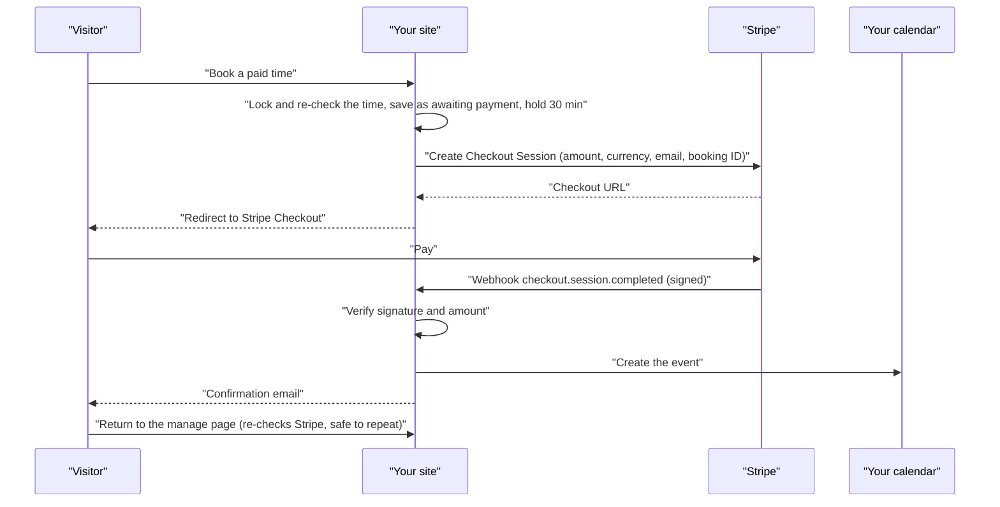
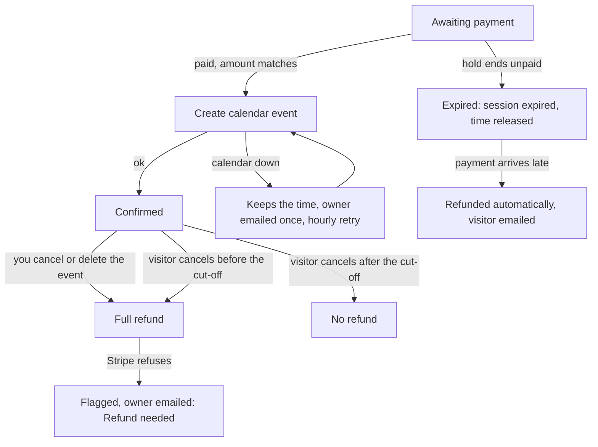

# Payments with Stripe

Give any appointment type a price and visitors pay on Stripe's hosted Checkout page before the booking is confirmed. Card details never touch your site. Free types keep working exactly as before.

## What it does

| Feature | Details |
| --- | --- |
| Paid types | Set a **Price** on an appointment type. Paid types are hidden from visitors until Stripe is set up |
| Hold while paying | The time is held for **30 minutes** while the visitor pays, so nobody else can take it |
| Confirmation | The booking is confirmed only after Stripe reports the payment as paid: by webhook, when the visitor returns from Stripe, or by the hourly check. Nothing is confirmed on the browser's word alone |
| Amount check | The amount and currency paid must match the booking exactly, or it isn't confirmed |
| Abandoned checkout | When the hold ends unpaid, the Stripe session is expired and the time is released |
| Late payment | A payment that arrives after the hold was released is refunded automatically and the visitor is emailed, so the time is never double-booked |
| Calendar down after payment | The paid booking keeps its time, you're emailed once ("Paid booking waiting for your calendar"), and the hourly task retries until the event is created |
| Refunds | Always in full when you cancel or delete the event in your calendar. When the visitor cancels: in full if it's before **Refund visitor cancellations until** (default 24 hours before), otherwise none |
| Failed refund | Flagged on the booking and emailed to you ("Refund needed") |
| No duplicates | Every Stripe write carries an idempotency key; a refund for a booking can only happen once |
| Test mode | `sk_test_…` keys put payments in Stripe's test mode |

## Setup

| Step | Where | What to do |
| --- | --- | --- |
| 1 | Stripe → Developers → API keys | Copy the **Secret key**. Start with the test key (`sk_test_…`) |
| 2 | Stripe → Developers → Webhooks | Add an endpoint with the address shown in the plugin (normally `https://your-site/wp-json/jatcs/v1/stripe`) and the events `checkout.session.completed`, `checkout.session.expired`, `checkout.session.async_payment_succeeded`, `checkout.session.async_payment_failed` |
| 3 | Same page | Copy the endpoint's **Signing secret** (`whsec_…`) |
| 4 | Appointments → Settings → Payments (Stripe) | Paste **Secret key** and **Webhook signing secret**, set **Currency** (for example `USD`) and **Refund visitor cancellations until … hours before**, then **Save settings** |
| 5 | Appointments → Appointment types | Edit a type and set its **Price** |
| 6 | Your booking page | Book the paid type with Stripe's test card `4242 4242 4242 4242` to try it |
| 7 | When ready | Swap in your live secret key and a live-mode webhook signing secret |

Both secrets are stored encrypted, or can be defined as `JATCS_STRIPE_SECRET_KEY` and `JATCS_STRIPE_WEBHOOK_SECRET` in `wp-config.php`. Without the webhook, bookings still confirm when visitors return from paying, or within the hour.

> **Sites moved from Anderson Appointment Booking:** the old webhook address `/wp-json/aab/v1/stripe` keeps working, and checkouts started before the switch still confirm.

## How a paid booking flows

## Troubleshooting

| Symptom | Cause | Fix |
| --- | --- | --- |
| Paid types don't appear on the booking page | No valid Stripe secret key saved | Paste an `sk_test_…` / `sk_live_…` key (restricted `rk_…` keys work too) and save |
| "Online payment isn't available right now…" | Stripe isn't set up or the key was removed | Check **Payments (Stripe)** settings |
| "Payment couldn't be started. Try again in a minute." | Stripe couldn't be reached or rejected the request | Check **Recent problems** at the bottom of the settings page; check the key's mode (test vs live) |
| Paid bookings confirm only after an hour | Webhook missing or its signing secret is wrong | Add the webhook and paste its signing secret; Stripe's webhook page shows failed deliveries |
| Webhook deliveries fail with 400 | Signing secret from a different endpoint or mode | Copy the signing secret of this exact endpoint |
| "[site] Refund needed" email | Stripe refused the refund (for example already refunded in the dashboard) | Refund manually in Stripe if needed |
| "[site] Paid booking waiting for your calendar" | Paid, but the booking calendar couldn't be reached | Fix the calendar connection; the hourly task adds the event and confirms the booking |

Related: [Appointment types and questions](Appointment-Types-and-Questions) · [Rescheduling and cancelling](Rescheduling-and-Cancelling) · [Emails and reminders](Emails-and-Reminders) · [REST API](REST-API) · [Security and privacy](Security-and-Privacy)
