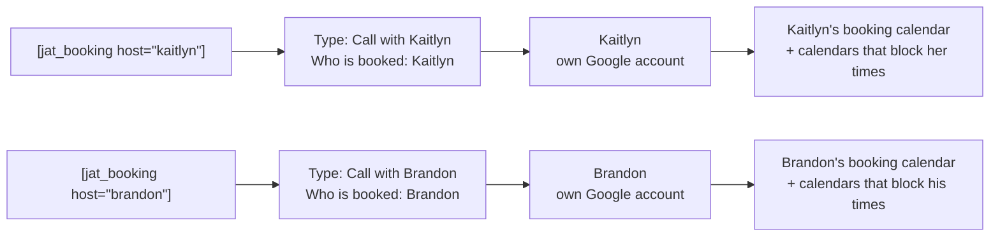

# People

Book several people separately on one site, each with their own Google Calendar. A real estate team, a practice with several therapists, a studio with several teachers: each person's page shows only their own open times, and each booking lands in that person's calendar.

The site owner's own setup (Appointments → Settings) stays as it is and is the default. A site that never adds people works exactly as before.

## How it fits together



| Kept per person | Shared by everyone (Settings) |
| --- | --- |
| Google account and its tokens | The Google app (client ID and secret) |
| Where bookings go, calendars that block times | Buffers, notice, booking window, days off, reminders |
| Who gets booking notices (and visitors' replies) | Emails' wording, consent text, phone field, appearance |
| Their bookings, slot locks and daily cap | Stripe, Outlook, CalDAV and iCal feeds (the site owner's) |

Weekly hours come from each appointment type (choose "Use different hours for this type"), so each person's types can have their own hours.

## Set up a person

1. **Appointments → Settings**: the site's Google app (client ID and secret) must be set up, and the app published to In production. Everyone signs in through it.
2. **Appointments → People → Add person**: their name and the address for their booking notices. The slug (made from the name) is what goes in the shortcode.
3. **Make their connect link** and send it to them privately. It works once, for 7 days, and needs no WordPress login: they open it, pick their Google account and allow access. Or click **Connect here instead** to sign in with their account in your own browser.
4. Back on their page: choose **Bookings go to** and which calendars **also block times**, then save.
5. **Appointments → Appointment types**: add a type and set **Who is booked** to them.
6. Place `[jat_booking host="their-slug"]` (or the block with its `host` attribute) on their page.

Until steps 3 and 5 are done, the shortcode renders nothing, so it can go on their page first. Disconnecting them, or hiding their last type, hides it again.

## For themes

```php
if ( function_exists( 'jatcs_host_ready' ) && jatcs_host_ready( 'kaitlyn' ) ) {
	echo '<h2>Book a call</h2>' . do_shortcode( '[jat_booking host="kaitlyn"]' );
}
```

`jatcs_host_ready( $slug )` is true when the person's Google Calendar is connected and they have a visible appointment type. Pass `''` for the site owner.

## When access stops working

If Google stops accepting a person's access (they removed it from their Google account, or the app was left in Testing), their calendar is hidden and the site owner is emailed a link to make them a new connect link. The People list shows "Access expired: reconnect".

## What's stored

A person's Google tokens are stored like the site owner's (encrypted), in `jatcs_google__{slug}`; people are in `jatcs_hosts`; each booking records its person in `_jatcs_host`. Connect links are stored only as a hash. Removing a person revokes their Google access; uninstalling revokes everyone's.
