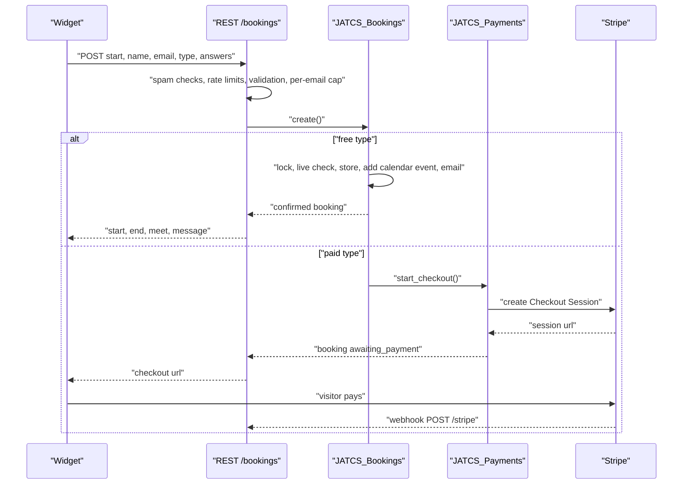
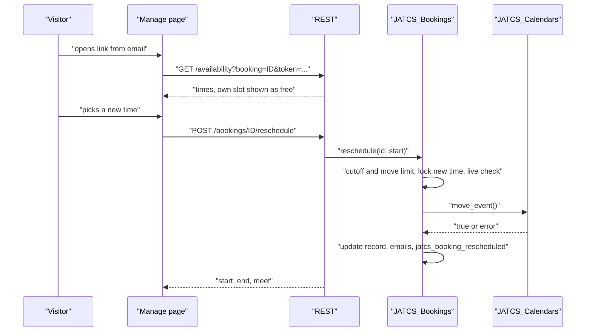

# REST API

The booking widget and the manage page use a small public REST API. Every route is registered under `jatcs/v1` and, for sites moved from Anderson Appointment Booking, also under `aab/v1` (same handlers, same behavior). Pages cached before the switch and Stripe webhooks registered under the old address keep working.

Base URL: `https://your-site.example/wp-json/jatcs/v1`

| Method | Route | Auth | Purpose |
| --- | --- | --- | --- |
| `GET` | `/availability` | Public; reschedule view needs the booking's token | Open start times for a date range |
| `POST` | `/bookings` | Public, spam checks and rate limits | Book a time (or start a Stripe Checkout for a paid type) |
| `POST` | `/bookings/{id}/reschedule` | Emailed token | Move a booking to a new time |
| `POST` | `/stripe` | Stripe signature (`Stripe-Signature` header) | Stripe webhook |

All responses are JSON. Errors use the standard WordPress shape: `{"code": "...", "message": "...", "data": {"status": 400}}`. The `message` is written for visitors and is translated.

## GET /availability

| Parameter | Type | Required | Default | Notes |
| --- | --- | --- | --- | --- |
| `from` | string `Y-m-d` | Yes | | First date, site time zone |
| `to` | string `Y-m-d` | Yes | | Last date, inclusive; at most 42 days after `from` |
| `type` | string | No | `''` | Appointment type ID. Empty: the first active type. |
| `booking` | integer | No | `0` | Booking being rescheduled: its own time counts as free and its own type is used |
| `token` | string | With `booking` | `''` | The booking's emailed token |

Response (`Cache-Control: no-store`):

```json
{
  "timezone": "America/New_York",
  "type": "intro-call",
  "duration": 30,
  "first": "2026-11-03",
  "last": "2026-11-15",
  "days": {
    "2026-11-03": [1793714400, 1793716200],
    "2026-11-04": []
  }
}
```

`days` maps each date in the requested range that falls inside the booking window to a list of Unix start times. `first` and `last` are the booking window; with shift-work mode `last` is the end of the posted schedule, and it can be before `first` when nothing is posted.

```bash
curl "https://your-site.example/wp-json/jatcs/v1/availability?from=2026-11-03&to=2026-11-30&type=intro-call"
```

## POST /bookings

| Parameter | Type | Required | Default | Notes |
| --- | --- | --- | --- | --- |
| `start` | integer | Yes | | Unix start time, one of the offered times |
| `name` | string | Yes | | 1 to 100 characters |
| `email` | string | Yes | | Valid email |
| `notes` | string | No | `''` | Up to 2,000 characters; ignored when the type has notes turned off |
| `phone` | string | No | `''` | Ignored when the phone field is off; required when set to required |
| `type` | string | No | `''` | Appointment type ID; empty means the first active type |
| `answers` | object | No | `{}` | Answers to the type's questions, keyed by question ID |
| `consent` | boolean | No | `false` | Must be true when a consent text is set |
| `website` | string | No | `''` | Honeypot: must be empty |
| `elapsed` | integer | No | `0` | Seconds the form was open; must be at least 3 |

Response for a free type:

```json
{
  "start": 1793714400,
  "end": 1793716200,
  "meet": "https://meet.google.com/abc-defg-hij",
  "type": "intro-call",
  "message": "You're booked. A confirmation is on its way to your inbox."
}
```

`meet` is the Google Meet or Microsoft Teams link, or an empty string.

Response for a paid type (the widget sends the visitor to `checkout`):

```json
{ "checkout": "https://checkout.stripe.com/c/pay/cs_test_...", "start": 1793714400 }
```

```bash
curl -X POST "https://your-site.example/wp-json/jatcs/v1/bookings" \
  -H "Content-Type: application/json" \
  -d '{"start":1793714400,"name":"Grace Hopper","email":"grace@example.org","type":"intro-call","elapsed":12}'
```



## POST /bookings/{id}/reschedule

| Parameter | Type | Required | Notes |
| --- | --- | --- | --- |
| `id` (path) | integer | Yes | Booking ID |
| `start` | integer | Yes | New Unix start time |
| `token` | string | Yes | The booking's emailed token |

Response:

```json
{ "start": 1793721600, "end": 1793723400, "meet": "https://meet.google.com/abc-defg-hij" }
```

The calendar event is moved in place, so the video link stays the same.



## POST /stripe

Stripe's webhook endpoint. The raw body is checked against `Stripe-Signature` with your webhook signing secret, allowing 300 seconds of clock skew. Handled events: `checkout.session.completed`, `checkout.session.async_payment_succeeded`, `checkout.session.expired`, `checkout.session.async_payment_failed`. The response is `{"result": "confirmed" | "pending" | "released" | "error" | "ignored"}`. Each event re-reads the session from Stripe, so a replayed or forged event can't confirm an unpaid booking.

## Error codes

| Code | HTTP | When |
| --- | --- | --- |
| `jatcs_bad_range` | 400 | `from`/`to` not valid dates, `to` before `from`, or more than 42 days |
| `jatcs_spam` | 400 | Honeypot filled or form sent in under 3 seconds |
| `jatcs_invalid` | 400 | Field errors; `data.fields` maps field name to message |
| `jatcs_same_time` | 400 | Rescheduling to the current time |
| `jatcs_bad_payload`, `jatcs_bad_signature` | 400 | Stripe webhook body or signature invalid |
| `jatcs_bad_link` | 403 | Booking ID and token don't match |
| `jatcs_too_many` | 403 | The email already has the maximum number of upcoming bookings |
| `jatcs_too_late` | 403 | Inside the change cut-off, or the appointment has started |
| `jatcs_too_many_moves` | 403 | Reschedule limit reached |
| `jatcs_bad_type` | 404 | Unknown, hidden, or paid type without payments set up |
| `jatcs_slot_taken` | 409 | Another request holds the time, or it is no longer free |
| `jatcs_not_confirmed` | 409 | Rescheduling a booking that isn't confirmed |
| `jatcs_rate` | 429 | Per-IP rate limit reached |
| `jatcs_google_failed` | 502 | The calendar service refused to create or move the event (the name is historical; it covers every service) |
| `jatcs_payments_failed` | 502 | Stripe couldn't create the Checkout Session |
| `jatcs_unavailable` | 503 | No usable booking calendar, or a calendar that blocks times can't be read |
| `jatcs_payments_off` | 503 | Paid type but Stripe isn't set up |

## Rate limits

Limits are per visitor IP, stored as transients `jatcs_rl_<bucket>_<hmac>`. The IP is `REMOTE_ADDR`; forwarding headers (`CF-Connecting-IP`, `X-Real-IP`, `X-Forwarded-For`) are only trusted when `REMOTE_ADDR` is a private or loopback address. Filter with [`jatcs_client_ip`](Hooks-and-Filters).

Each bucket is a fixed window: the first counted request starts the hour, and the count resets when that hour ends (later requests don't extend it).

| Bucket | Limit | Counts | Used by |
| --- | --- | --- | --- |
| `avail` | 300 per hour | Every request | `GET /availability` |
| `try` | 20 per hour | Every booking attempt | `POST /bookings` |
| `book` | 5 per hour | Successful bookings | `POST /bookings` |
| `move` | 10 per hour | Every attempt | `POST /bookings/{id}/reschedule` |

Related: [Architecture](Architecture) · [Hooks-and-Filters](Hooks-and-Filters) · [Security-and-Privacy](Security-and-Privacy) · [Payments-with-Stripe](Payments-with-Stripe) · [Rescheduling-and-Cancelling](Rescheduling-and-Cancelling)
