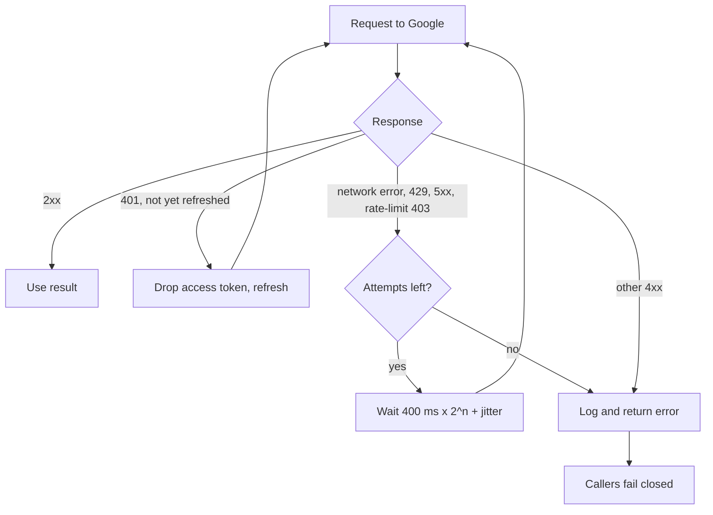
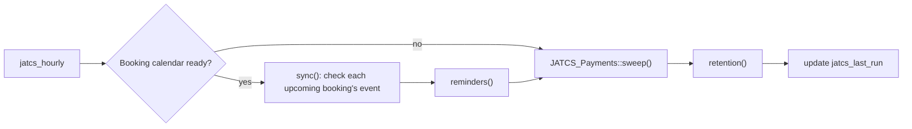

# Reliability and Site Health

The rule throughout: if the plugin can't be sure a time is free, it doesn't offer it. Retries are safe because every write to a calendar or to Stripe can be repeated without creating a second event or a second charge.

## Failing closed

| Situation | What visitors see | What happens |
| --- | --- | --- |
| No booking calendar, or Outlook is the booking calendar but was connected read-only | "Online booking is unavailable" (`jatcs_unavailable`, 503) | Site Health: recommended |
| Google refresh token revoked or expired (`invalid_grant`) | No times | `jatcs_google_error` set, one email to the owner, admin notice, Site Health critical. Cleared on reconnect. |
| Outlook refresh token refused | No times while Outlook calendars block times | `jatcs_ms_error` set, Site Health critical. No email. |
| A blocking calendar can't be read (timeout, 5xx after retries) | No times for that range; booking returns `jatcs_unavailable` | Logged; next request tries again |
| Outlook busy times longer than 25 pages | No times for that range | Treated as an error rather than guessing |
| iCal feed host down | Last good copy used for up to 6 hours | Retried at most every 5 minutes; after 6 hours the feed counts as unreadable |
| Creating the booking event fails (free type) | Error; nothing booked | Pending record deleted, lock released |
| Creating the event fails after payment | "Paid, adding to calendar" | Slot stays held, owner emailed once (`_jatcs_owner_alerted`), hourly task retries |

## Retries and idempotency

| Service | Retries | Why a retry can't duplicate |
| --- | --- | --- |
| Google | Up to 3 attempts on network errors, 429, 5xx and 403 `rateLimitExceeded`/`userRateLimitExceeded`; timeouts 8 s then 6 s; backoff 400 ms × 2^(n−1) plus up to 200 ms jitter. A 401 refreshes the access token once without using an attempt. | The event ID is chosen before the insert (`_jatcs_event_gid`); a 409 means an earlier try succeeded, and that event is used. |
| Outlook | GET and POST: 2 tries, 500 ms apart, on network errors, 429 and 5xx. PATCH and DELETE: 1 try. A 401 refreshes once. | Creates carry `transactionId` = the event UID, so Outlook makes the event once. |
| CalDAV | No automatic retry; the hourly task and the visitor can retry | Creates use `If-None-Match: *` (412 means it already exists); updates and deletes use `If-Match` with the ETag. |
| Stripe | One retry after 500 ms on network errors, 429 and 5xx, only for GETs and keyed POSTs | `Idempotency-Key` on every write |

## The hourly task

`jatcs_hourly` runs `JATCS_Maintenance::run()`:

| Step | Does |
| --- | --- |
| `sync()` | For each upcoming confirmed booking, reads its event. Deleted or cancelled: the booking is cancelled (`by` = `calendar`). Moved: start, end, date and title are updated, the reminder is reset and the visitor is emailed. All-day: left alone. Read errors: skipped until next hour. |
| `reminders()` | Sends the reminder for bookings starting within "reminder hours", once (`_jatcs_reminded`), and only if the booking was made before that window opened |
| `sweep()` | Up to 100 `awaiting_payment` bookings: paid ones are finalized again; others are checked with Stripe and released when the hold has ended |
| `retention()` | Deletes up to 100 records whose end is older than "delete after N days" (0 keeps them) |

If WP-Cron doesn't run on your host, add a server cron job that requests `wp-cron.php` every few minutes.

## Site Health

Four direct tests appear under Tools → Site Health with the badge "Appointments".

| Test ID | Label | Good | Recommended | Critical |
| --- | --- | --- | --- | --- |
| `jatcs_google` | JAT Calendar Sync: calendar connection | Booking calendar connected and every blocking calendar readable for the next 24 hours | No booking calendar, or Outlook needs reconnecting for write access | Google access expired or revoked, or a blocking calendar can't be read |
| `jatcs_outlook` | JAT Calendar Sync: Outlook calendars | Connected, or not in use | | `jatcs_ms_error` is set |
| `jatcs_cron` | JAT Calendar Sync: background tasks | Ran in the last 3 hours, or installed less than 3 hours ago, or no booking calendar | Hasn't run for over 3 hours | |
| `jatcs_timezone` | JAT Calendar Sync: timezone | Site time zone is a city | Site uses a fixed UTC offset (hours would shift at daylight saving) | |

## Problem log

The last 20 problems talking to Google, Outlook, CalDAV feeds and Stripe are kept in `jatcs_log` (`time`, `context` up to 80 characters, `message` up to 300) and shown on the settings screen. Stripe IDs in paths are shortened. Google 404, 409 and 410 and Outlook 404 responses are expected during sync and are not logged.

## Owner emails

| Email | Sent when |
| --- | --- |
| "Online booking is offline: reconnect Google Calendar" | The first time Google refuses the refresh token, until reconnected |
| Paid booking waiting for the calendar | Once per booking, when Stripe confirmed payment but the event couldn't be created |
| Refund needed | An automatic refund failed (a cancelled paid booking, or a payment that arrived after its hold expired) |

Related: [Architecture](Architecture) · [Troubleshooting](Troubleshooting) · [Data-and-Storage](Data-and-Storage) · [Google-Calendar](Google-Calendar) · [Outlook-and-Microsoft-365](Outlook-and-Microsoft-365) · [Payments-with-Stripe](Payments-with-Stripe)
