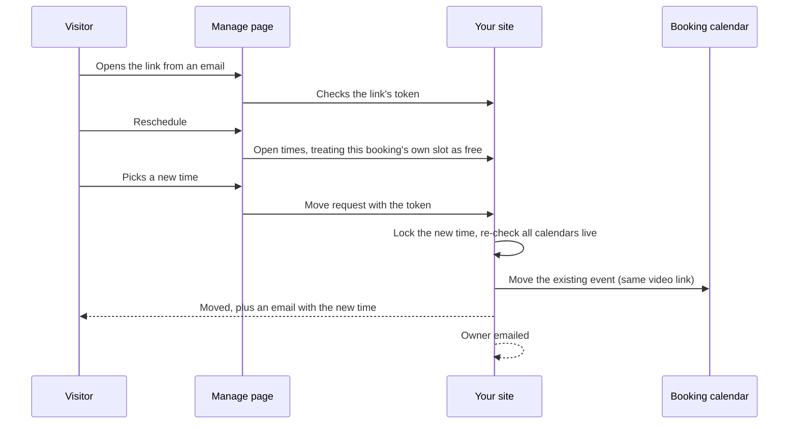
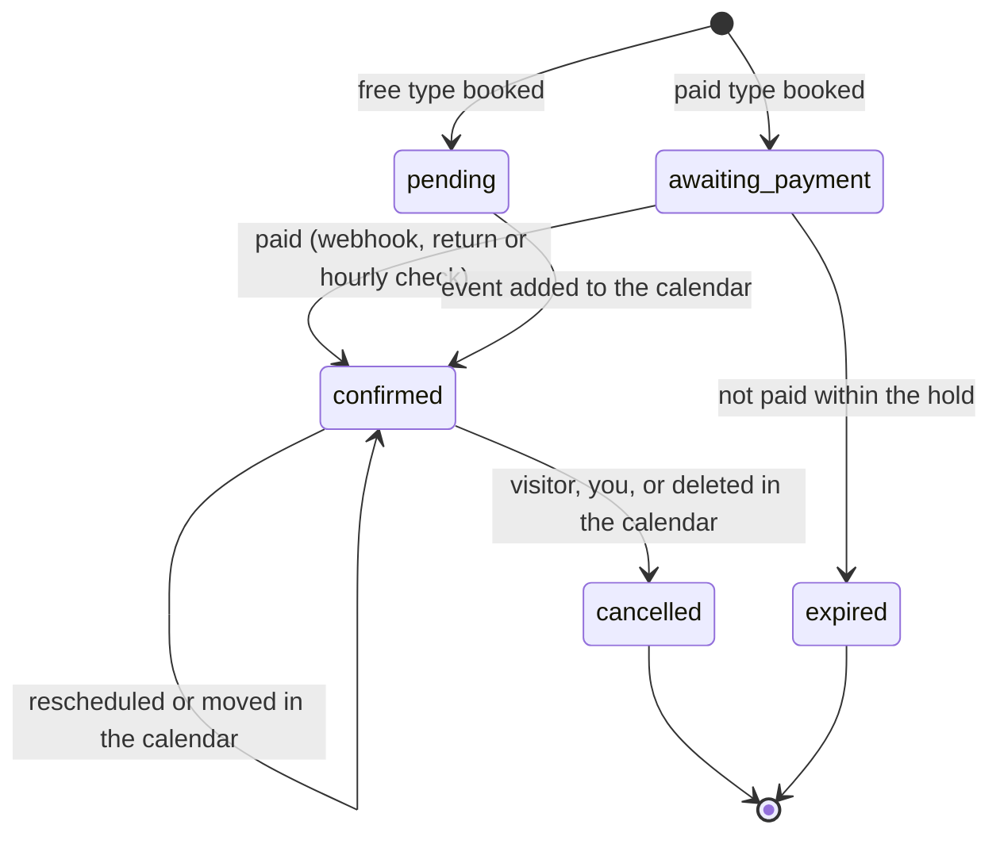

# Rescheduling and Cancelling

Every email to a visitor carries a private **manage link**. It opens a page styled like your site where they can see their appointment, move it to another open time, or cancel it. You can cancel from wp-admin, or by deleting the event in your calendar.

## Who can change what

| Who | How | Limits |
| --- | --- | --- |
| Visitor | Manage link → Reschedule | Until **Changes allowed until** (hours before); at most **Reschedules per booking** times |
| Visitor | Manage link → Cancel (with a confirmation button) | Until **Changes allowed until** |
| You | Appointments → Bookings → Cancel | Any time before it starts |
| You | Move to Trash in Bookings (upcoming, confirmed) | Cancels it in the calendar too |
| You | Move the event in your calendar | Picked up within the hour; visitor emailed the new time |
| You | Delete the event in your calendar | Picked up within the hour; booking cancelled, visitor emailed |

Cancelling is a button press behind a confirmation, not a link, so email security scanners that open links can't cancel appointments.

## Visitor reschedule

The calendar event is moved in place, so the Google Meet or Teams link and the guest invitation stay the same.

## Booking lifecycle

| Status | Holds the time | Visitor can change it | Bookings list shows |
| --- | --- | --- | --- |
| `pending` | Briefly, while the event is created | No | Not confirmed |
| `awaiting_payment` | Until the payment hold ends (for good once paid) | Pay or release from the manage page | Awaiting payment / Paid, adding to calendar |
| `confirmed` | Yes, plus its free time before and after | Reschedule or cancel until the cut-off | Confirmed / Past |
| `cancelled` | No | No | Cancelled / Deleted in your calendar |
| `expired` | No | No | Expired (not paid) |

## Refunds on cancel

| Who cancels | Refund |
| --- | --- |
| You (wp-admin, or deleting the event in your calendar) | Always, in full |
| Visitor, earlier than **Refund visitor cancellations until** (hours before) | In full |
| Visitor, later than that | None |

Refunds are requested from Stripe with an idempotency key, so a retried cancel can't refund twice. A failed refund is flagged on the booking and emailed to you. See [Payments with Stripe](Payments-with-Stripe).

## Manage link details

| Property | Value |
| --- | --- |
| Address | `https://your-site/?jatcs_manage=ID&jatcs_token=TOKEN` |
| Older links | `?aab_manage=…&aab_token=…` (before the rename) still work |
| Token storage | Only a hash is stored for checking; an encrypted copy lets later emails include the link |
| After cancelling | The link stops working |
| Search engines | `noindex, nofollow` |
| Wrong or expired link | "This link is no longer valid" (HTTP 403 from the API) |

Related: [Emails and Reminders](Emails-and-Reminders) · [Payments with Stripe](Payments-with-Stripe) · [REST API](REST-API)
