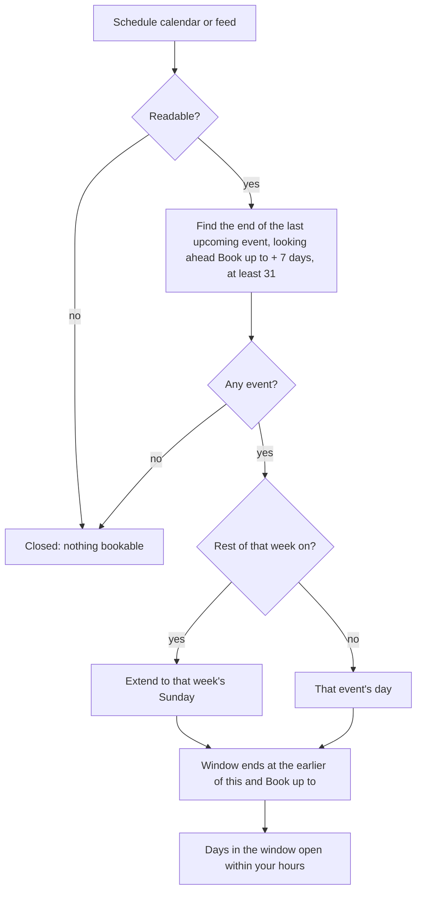
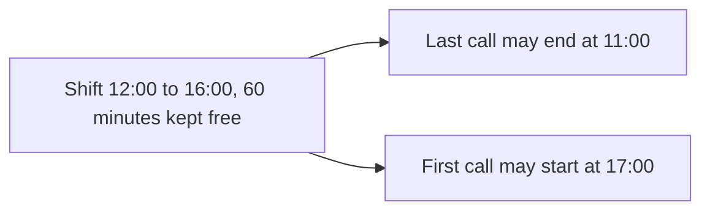

# Shift-work mode

If you also work shifts (Sling, When I Work, Deputy, 7shifts or any rota that lands in a calendar), shift-work mode makes booking follow your posted schedule:

- Booking opens only as far as your **last posted shift**, so nobody books a time that could still become a shift.
- When the next schedule is posted, those days open on their own.
- Every shift blocks its own time, plus free time you choose before and after it.

## What it does

| Setting (Where bookings go) | Default | Effect |
| --- | --- | --- |
| **Open booking only as far as** | My "Book up to" limit (off) | Choose the calendar or feed that holds your schedule. Booking closes after the end of its last upcoming event |
| **and the rest of that week, through Sunday** | On | Extends the window to the Sunday of the week holding the last posted shift (weeks run Monday to Sunday) |
| **Keep free before and after each shift** | 60 minutes | Clear time around every event on the schedule calendar. It counts toward your usual **Free time before / after** settings instead of adding to them, so the gap is at least this long, never longer than needed |

The schedule calendar can be on any service: a Google calendar, an Outlook calendar, a CalDAV calendar, or an [iCal feed](iCal-Feeds). Its events always block their own times, whether or not they're ticked elsewhere. The usual **Book up to** limit still applies; the schedule can only shorten the window, never extend it.

## Rules

| Situation | Result |
| --- | --- |
| Shifts posted through Thursday, "rest of that week" on | Bookable through Sunday of that week |
| Same, "rest of that week" off | Bookable through Thursday |
| Nothing posted in the next weeks | Nothing can be booked |
| The schedule calendar can't be read | Nothing can be booked (checked again within 2 minutes) |
| Last posted shift is beyond **Book up to** | **Book up to** wins |
| A day inside the window with no shift | Bookable within your hours |

The settings page shows the current result, for example **"Right now: booking is open through November 15, 2026."** The schedule end is recalculated at most every 15 minutes.

## Setup

| Step | Where | What to do |
| --- | --- | --- |
| 1 | Your scheduling app | Copy its calendar subscription link, or make sure your shifts land in a Google, Outlook or CalDAV calendar |
| 2 | Appointments → Settings → iCal feeds | Add the link as a feed (fastest: checked every 10 minutes) |
| 3 | Where bookings go → **Open booking only as far as** | Choose "my posted schedule on …" for that calendar or feed |
| 4 | Same row | Leave **and the rest of that week, through Sunday** on if days without shifts after your last shift should stay open |
| 5 | Same row | Set **Keep free before and after each shift** (minutes) |
| 6 | When people can book → **Book up to** | Set it at least as far ahead as your schedule is usually posted (for example 21 days), so it doesn't cut a posted week short |

## How the window is worked out

## Troubleshooting

| Symptom | Cause | Fix |
| --- | --- | --- |
| "Right now: no upcoming schedule found, so booking is closed." | No future events on the schedule calendar, or it can't be read | Check the feed or calendar has your posted shifts; see **Recent problems** |
| A new week isn't bookable yet | The schedule hasn't reached the plugin yet. Feeds are checked every 10 minutes; a Sling calendar subscribed inside Google Calendar can take Google several hours to refresh | Add the schedule as an [iCal feed](iCal-Feeds) directly instead of through Google |
| Booking stops earlier than the posted schedule | **Book up to** is shorter | Raise **Book up to** |
| Booking stays open far into the future | The schedule calendar also has a recurring or far-future event (for example a weekly meeting with no end) | Use a calendar or feed that holds only shifts |
| Times right after a shift are missing | The free time around shifts | Lower **Keep free before and after each shift** |

Related: [iCal feeds](iCal-Feeds) · [Availability rules](Availability-Rules) · [Calendar services](Calendar-Services) · [Settings reference](Settings-Reference)
