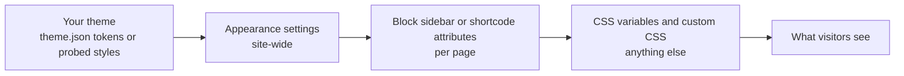

# Styling and Theming

The booking calendar is built to look like part of your site, not a widget pasted in. By default it takes your theme's fonts, text color, accent color, buttons, fields and corner radius. You can then fine-tune it in four places, each overriding the one before.



## How the theme is read

| Theme kind | What's read |
| --- | --- |
| Block themes (theme.json) | Color palette, primary/accent color, button styles, border radius, heading and body fonts |
| Classic themes | The page's computed styles in the browser: link and button colors, fonts, corner radius |

The **Appearance** card names the theme it matched ("Match my theme also pulls colors, buttons, corners and heading font from Twenty Twenty-Five").

## Appearance settings

**Appointments → Settings → Appearance**, with a live preview rendered inside your theme (Wide or Phone).

| Setting | Choices | Default |
| --- | --- | --- |
| Accent color | Match my theme / Choose a color (palette swatches or any color) | Match my theme |
| Booking button and form fields | Use my theme's buttons and fields / Use the calendar's own style | Theme's |
| Corners | Match my theme / Square / Slightly rounded / Rounded / Very rounded | Match my theme |
| Spacing | Compact / Comfortable / Roomy | Comfortable |
| Calendar background | None / My theme's page color / Choose a color | None |
| Headings | My theme's heading font / Same font as the text around it | Theme's |
| Custom CSS | Any CSS, scoped by you | Empty |

## Per page

| Place | Options |
| --- | --- |
| Block sidebar | Heading, type, accent, background, buttons, corners, spacing, headings; plus the editor's color, typography and spacing controls |
| Shortcode | `heading`, `type`, `accent`, `background`, `buttons`, `radius`, `density`, `headings` (see [Block and Shortcode](Block-and-Shortcode)) |

## CSS variables

Set these on `.jatcs` (or a wrapper) to change the look without fighting selectors.

| Variable | Controls |
| --- | --- |
| `--jatcs-accent` | Selected day, chosen time, primary button |
| `--jatcs-on-accent` | Text on the accent color |
| `--jatcs-text` | Main text color |
| `--jatcs-muted` | Secondary text |
| `--jatcs-line` | Borders and dividers |
| `--jatcs-surface` | Calendar background |
| `--jatcs-soft` | Subtle fills (hover, unavailable days) |
| `--jatcs-tint` | Light accent tint (open days) |
| `--jatcs-error` | Error text and borders |
| `--jatcs-radius` | Base corner radius |
| `--jatcs-r-box`, `--jatcs-r-ctl`, `--jatcs-r-day` | Radius of the panel, controls and day cells |
| `--jatcs-space`, `--jatcs-gap`, `--jatcs-pad` | Spacing scale |
| `--jatcs-heading-font` | Font for headings in the widget |
| `--jatcs-max-width` | Maximum width of the widget |

```css
/* Example: brand green, square corners, a bit more air. */
.jatcs {
	--jatcs-accent: #1f6a2b;
	--jatcs-radius: 0;
	--jatcs-space: 1.15rem;
}
```

## Main class names

| Class | Element |
| --- | --- |
| `.jatcs` | The widget root (modifiers like `.jatcs--density-compact`, `.jatcs--buttons-theme`) |
| `.jatcs__types`, `.jatcs__type` | Type picker and each type card |
| `.jatcs__cal`, `.jatcs__day` (`.is-open`, `.is-selected`) | Month grid and days |
| `.jatcs__times`, `.jatcs__time` | Time list and each time button |
| `.jatcs__form`, `.jatcs__field`, `.jatcs__submit` | Booking form |
| `.jatcs__done` | Confirmation panel |
| `.jatcs-manage` | The visitor manage page |

## Layout and accessibility

| Feature | Detail |
| --- | --- |
| Responsive | Uses container queries: calendar and times sit side by side when there's room, stack when narrow |
| Keyboard | Arrow keys move between days; every control is a real button or field |
| Screen readers | Labelled regions, live status messages, visible timezone note |
| Weight | No libraries; CSS and JS load only on pages that show the widget |

## Turning off the plugin's stylesheet

```php
add_filter( 'jatcs_enqueue_styles', '__return_false' );
```

Then style everything from your theme. Other styling filters (`jatcs_theme_tokens`, `jatcs_style_vars`) are in [Hooks and Filters](Hooks-and-Filters).

Related: [Block and Shortcode](Block-and-Shortcode) · [Settings Reference](Settings-Reference)
