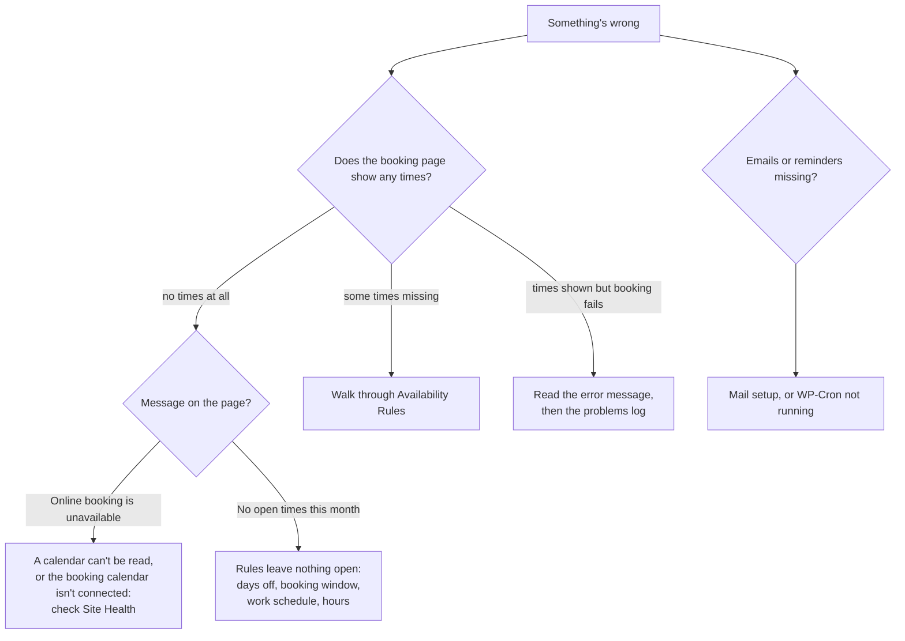

# Troubleshooting

Start with **Tools → Site Health** and the **Recent problems talking to your calendars** log at the bottom of **Appointments → Settings**. Most problems show up there with a reason.

## Where to look

## Booking page

| Symptom | Likely cause | Fix |
| --- | --- | --- |
| "Online booking is unavailable right now" | The booking calendar's service isn't connected, or a calendar that blocks times can't be read | Site Health names the calendar. Reconnect it, or untick it |
| "No open times this month" | Days off cover the month, the booking window ended, or the work schedule hasn't been posted | Check **Days off**, **Book up to**, and "Right now: booking is open through…" |
| Booking stopped at the start of a month | A days-off range blocks everything from a date onward | Remove it under **Days off** |
| Times stop at the end of the work week | Shift-work mode: the next schedule isn't posted (or hasn't reached your calendar yet) | Expected; it opens when the schedule appears |
| A time you're free at isn't offered | Buffers, minimum notice, spacing, or a busy event on another blocking calendar | See [Availability Rules](Availability-Rules) |
| Holidays or vacations don't block | All-day events are usually marked **Free** | Set them to **Busy**, or add **Days off** |
| "That time was just taken" | Someone booked it first, or a calendar changed since the page loaded | Pick another time (the page refreshes times) |
| "Too many bookings from your connection" | Rate limit (5 bookings per hour per connection) | Wait, or book by email |

## Calendars

| Symptom | Likely cause | Fix |
| --- | --- | --- |
| Google stops working after 7 days | The Google OAuth app is in **Testing** | Publish it to **In production**, then reconnect |
| Google "insufficient authentication scopes" (old logs) | Versions before 1.4.1 | Already fixed; clear the log |
| Outlook can't receive bookings | Connected read-only | Click **Allow adding bookings to Outlook** |
| Outlook admin approval needed | Work tenant blocks user consent for write access | Ask your Microsoft 365 admin, or use Outlook only to block times |
| iCloud says the password is wrong | Using your Apple Account password | Create an app-specific password at account.apple.com |
| CalDAV calendar missing from the list | It holds tasks only, or the account lacks access | Check in the provider's web calendar |
| Feed: "larger than 5 MB" | Full export with years of history | Use a subscription link with fewer past events |
| Feed: "answered with an error (HTTP 404)" | The link was reset or expired | Copy a fresh link from the app |
| New shifts take hours to appear | The schedule is a subscribed calendar inside Google | Add the app's link directly as an iCal feed (checked every 10 minutes) |

## Emails and background tasks

| Symptom | Likely cause | Fix |
| --- | --- | --- |
| No emails at all | The host's PHP mail is blocked | Install an SMTP or transactional mail plugin |
| Reminders never arrive | WP-Cron isn't running (disabled, or no traffic) | Add a server cron hitting `wp-cron.php` every few minutes; Site Health warns after 3 hours |
| Moves in the calendar aren't reflected | Same: the hourly task isn't running | As above; or **Check calendars now** in Settings |

## Plugins page

| Symptom | Likely cause | Fix |
| --- | --- | --- |
| "Two copies of JAT Calendar Sync are active" | Installed twice in different folders | Deactivate one, then delete its folder |
| Deleting an old Anderson Appointment Booking copy hangs on "Deleting…" | Old copy's uninstall clashes with a running copy (versions before 1.4.2) | Remove its folder with your host's file manager, or migrate first (see [Migrating](Migrating-from-Anderson-Appointment-Booking)) |

## Still stuck?

Open an issue on [GitHub](https://github.com/CptNope/JAT-Calendar-Sync/issues) with your WordPress and PHP versions, which calendars you use, and the lines from **Recent problems talking to your calendars**. Never paste client secrets, app passwords or feed links.

Related: [FAQ](FAQ) · [Reliability and Site Health](Reliability-and-Site-Health) · [Availability Rules](Availability-Rules)
