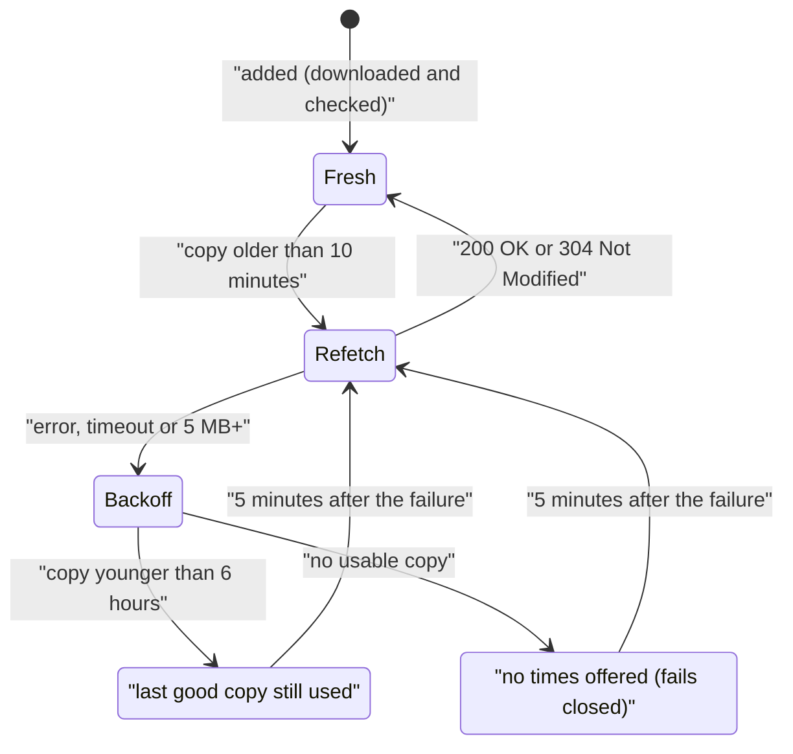

# iCal feeds

An iCal (ICS) feed is a calendar subscription link: a private address that returns the calendar as a `.ics` file. Almost every calendar and scheduling app offers one, so feeds are the easiest way to make any calendar block times: Sling, When I Work, Deputy and 7shifts schedules, iCloud shared calendars, Outlook published calendars, Google's secret address in iCal format, Proton Calendar, Teamup, Airbnb and more.

Feeds are **read only**: they block times or set your work schedule, but bookings can't be added to them.

## What it does

| Feature | Details |
| --- | --- |
| Blocks times | Every event in the feed, unless it's marked Free (transparent), cancelled, or shown as Free in Outlook (`X-MICROSOFT-CDO-BUSYSTATUS:FREE`). Tentative events do block. Untick **Blocks times** to keep a feed only as a work schedule |
| Recurring events | Daily, weekly, monthly and yearly rules, intervals, counts and end dates, by-day/by-month rules, exceptions (EXDATE, RDATE, moved and cancelled occurrences) |
| Time zones | IANA names, Windows names used by Outlook/Exchange, VTIMEZONE blocks in the file, and floating times |
| Work schedule | Any feed can be chosen under **Open booking only as far as** (see [Shift-work mode](Shift-Work-Mode)) |
| Limits | Up to **20** feeds; each feed must be under **5 MB** |
| Privacy | The address is encrypted; afterwards only its host is shown (for example `feeds.example.com/…`). No visitor data is ever sent to the feed's server |
| Safety | Only public internet addresses are fetched (local and private network addresses are refused). A malicious or huge recurrence rule can't hang your site: anything it can't fully work out counts as busy |

## Setup

| Step | Where | What to do |
| --- | --- | --- |
| 1 | Your calendar or scheduling app | Copy the calendar's subscription link (often called "iCal", "ICS", "Subscribe" or "Export to calendar"). It usually starts with `https://` or `webcal://` |
| 2 | Appointments → Settings → iCal feeds | Paste it into **Add a feed**, give it a **Name** (for example "Work shifts") and click **Add feed** |
| 3 | Same table | The plugin downloads and checks it straight away. Keep **Blocks times** ticked if its events should hide times, then **Save settings** |
| 4 | Where bookings go | Optional: choose it under **Open booking only as far as** to make booking follow a posted work schedule |

## Fetching and caching

| Rule | Value |
| --- | --- |
| Re-download after | 10 minutes (conditional request with ETag / Last-Modified, so unchanged feeds cost almost nothing) |
| After a failed download | Wait 5 minutes before trying again, so visitors aren't slowed by an unreachable server |
| Last good copy used for | Up to 6 hours while the feed is unreachable |
| Then | No times are offered until the feed can be read again |
| Incomplete data | A feed cut off part-way (unmatched `BEGIN:VEVENT` / `END:VEVENT`, or no `END:VCALENDAR`) is treated as unreadable, never half-read |

## Where to find the link

| App | Where |
| --- | --- |
| Sling | Your profile's calendar sync / subscribe option |
| Google Calendar | Settings → your calendar → Integrate calendar → **Secret address in iCal format** |
| iCloud | Calendar app → share the calendar → **Public Calendar** → copy link |
| Outlook on the web | Settings → Calendar → Shared calendars → **Publish a calendar** → ICS link |
| Proton Calendar | Calendar settings → Share via link |

Menu names change between app versions; look for "subscribe", "publish", "ICS" or "iCal".

## Troubleshooting

| Symptom | Cause | Fix |
| --- | --- | --- |
| "That doesn't look like a calendar feed address…" | Not a web address | Copy the subscription link, not the calendar's page address |
| "That address answered, but not with a calendar…" | The link points to a web page or login screen | Copy the iCal / ICS subscription link |
| "The calendar feed answered with an error (HTTP 404)…" | The link was reset or expired in the source app | Copy the new link, remove the old feed and add it again |
| "The calendar feed is larger than 5 MB…" | Years of history in the feed | Use a feed with fewer past events, or connect the calendar directly ([Google Calendar](Google-Calendar), [iCloud and CalDAV](iCloud-and-CalDAV)) |
| "You can add up to 20 calendar feeds." | Limit reached | Remove feeds you no longer need |
| New shifts take a while to block times | The feed is re-downloaded every 10 minutes; some apps update their feed slowly too | Wait; adding the feed directly is faster than subscribing to it in Google Calendar first |
| All-day events don't block | They are marked Free (transparent) in the source app | Mark them Busy, or add the dates under **Days off** |
| No times offered | The feed has been unreachable for over 6 hours | Check **Last checked** in the feeds table and **Recent problems** at the bottom of the settings page |

Related: [Calendar services](Calendar-Services) · [Shift-work mode](Shift-Work-Mode) · [iCloud and CalDAV](iCloud-and-CalDAV) · [Availability rules](Availability-Rules) · [Security and privacy](Security-and-Privacy)
