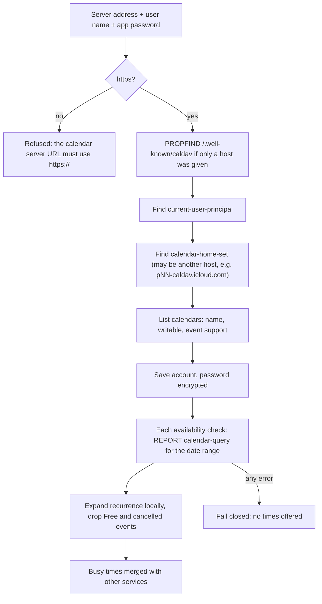
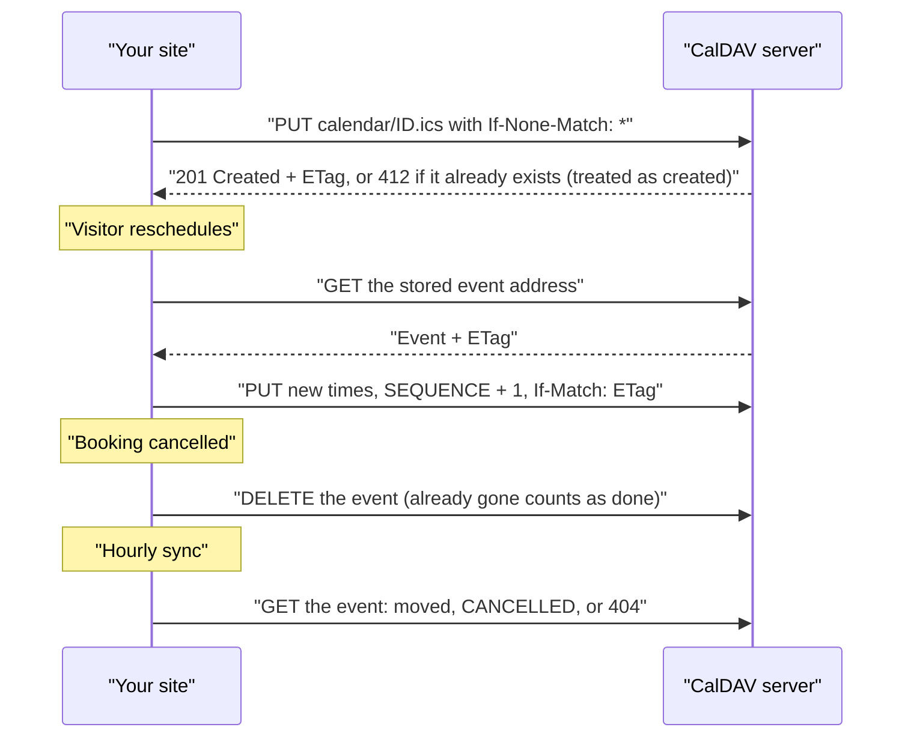

# iCloud and CalDAV

CalDAV is the open standard behind iCloud, Fastmail, Nextcloud, Zoho Calendar, Yahoo Calendar, mailbox.org and self-hosted servers such as Radicale, Baïkal, SOGo and Synology. Connect one CalDAV account and its calendars can block times, and any calendar you can write to can be where new bookings go.

## What it does

| Feature | Details |
| --- | --- |
| Blocks times | Events in calendars ticked under **Block times that are busy in**. Recurring events are expanded; events marked Free (transparent) and cancelled events don't block |
| Receives bookings | Any calendar the server reports as writable; read-only and subscribed calendars are marked **(read only)** and can only block times |
| Video link | None (CalDAV has no built-in video meetings). Set a location on the appointment type if needed |
| Guest invitation | The plugin's confirmation email carries a calendar file (`.ics`) instead |
| Follows your changes | Moving the event, marking it cancelled, or deleting it in your calendar app updates or cancels the booking within the hour |
| Duplicates | Each booking's event file is named after a fixed ID and created with `If-None-Match: *`, so a retry can't make a second event |
| Safe moves | Moves are written with the event's ETag (`If-Match`), so a change made in your calendar app at the same moment isn't overwritten; alarms on the event are kept |
| Credentials | User name plus an **app-specific password**, encrypted at rest. Never sent over plain HTTP, and never sent to another site on a redirect |

## Services and addresses

The **Service** list fills in the server address for you.

| Service | Server address | Password to use |
| --- | --- | --- |
| iCloud | `https://caldav.icloud.com/` | App-specific password: account.apple.com → Sign-In and Security → App-Specific Passwords. User name is your Apple Account email |
| Fastmail | `https://caldav.fastmail.com/dav/` | App password with CalDAV access (Settings → Privacy & Security) |
| Nextcloud | `https://YOUR-SERVER/remote.php/dav` | App password (Personal settings → Security) |
| Zoho Calendar | `https://calendar.zoho.com/caldav/` | Application-specific password (Zoho Accounts → Security) |
| Yahoo Calendar | `https://caldav.calendar.yahoo.com/` | App password (Yahoo Account Security) |
| mailbox.org | `https://dav.mailbox.org/caldav/` | Account password, or an app password with two-factor authentication |
| Other CalDAV server | Your server's address; the server root is enough if it supports `/.well-known/caldav` | As configured |

## Setup

| Step | Where | What to do |
| --- | --- | --- |
| 1 | Your provider's account security page | Create an app-specific password (your normal password usually won't work) |
| 2 | Appointments → Settings → iCloud, Fastmail, Nextcloud and other CalDAV calendars | Pick the **Service**; check the **Server address** |
| 3 | Same section | Enter **User name or email** and **App-specific password**, then click **Connect** |
| 4 | Block times that are busy in | Tick the calendars whose events should hide times, then **Save settings** |
| 5 | Where bookings go | Optional: choose a CalDAV calendar under **Add bookings to** |

## How discovery and bookings work

The calendar list is cached for 10 minutes; busy times are read live (with the plugin's usual 2-minute cache between visitor requests).

## Troubleshooting

| Symptom | Cause | Fix |
| --- | --- | --- |
| "Username or app-specific password was rejected by the calendar server." | Wrong user name, or your normal password was used | Create an app-specific password and use your full email as the user name |
| "The calendar server URL must use https://…" | The address starts with `http://` | Use the `https://` address |
| "The calendar server redirected to an insecure (non-HTTPS) address…" | The server sends you to `http://` | Fix the server's HTTPS setup, or enter its final `https://` address |
| "This URL does not appear to be a CalDAV server…" or "…did not report a CalDAV principal" | The address isn't the CalDAV endpoint | Use the address in the table above; for Nextcloud include `/remote.php/dav` |
| "The calendar server refused access (403)…" | The account can't use that calendar | Check sharing permissions on the server |
| A calendar shows **(read only)** | It's shared to you read-only, or it's a subscribed calendar | It can block times but can't receive bookings |
| Reschedule fails with "Your appointment could not be moved right now" | The event changed on the server at the same moment (ETag mismatch) or the server is down | Try again; the hourly sync picks up the server's version |
| No times offered | A ticked CalDAV calendar can't be read | See **Recent problems talking to your calendars** and Tools → Site Health |

Related: [Calendar services](Calendar-Services) · [iCal feeds](iCal-Feeds) · [Shift-work mode](Shift-Work-Mode) · [Security and privacy](Security-and-Privacy) · [Troubleshooting](Troubleshooting)
